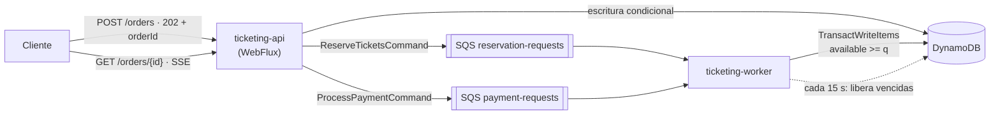
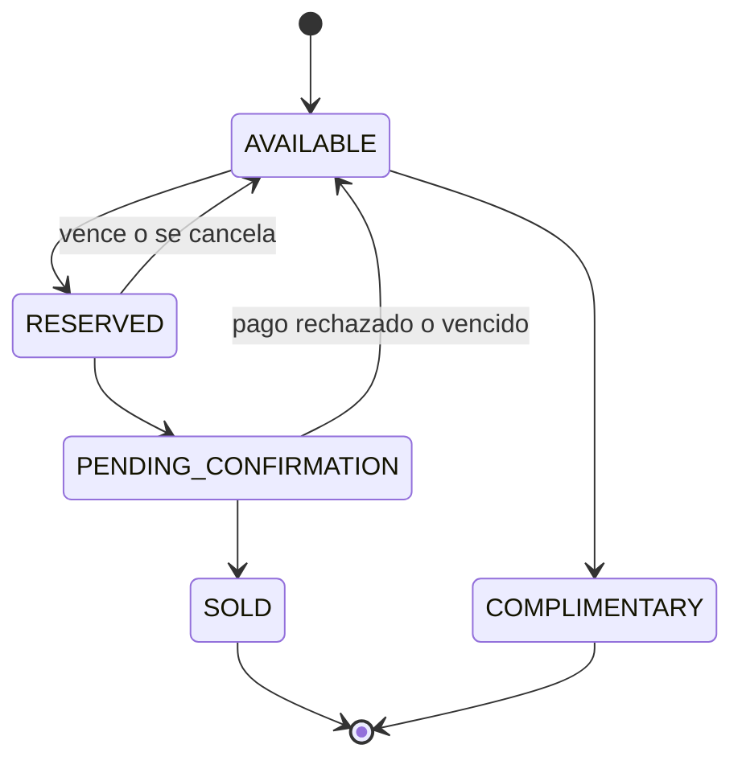

# Reactive Ticketing Platform

Backend **reactivo y orientado a eventos** para la venta de entradas a eventos (conciertos, teatro, deportes). Gestiona el inventario en tiempo real, procesa las compras de forma **asíncrona mediante colas** y garantiza que **nunca se vendan más entradas de las disponibles**, manteniendo tiempos de respuesta bajos bajo alta concurrencia.

> Java 25 · Spring Boot 4 · Spring WebFlux · Project Reactor · DynamoDB · SQS · Docker · Clean Architecture · Terraform (AWS)

La documentación completa de arquitectura (atributos de calidad, modelo C4, DDD, patrones, seguridad, AWS y 16 ADR) está en **[docs/ARCHITECTURE.md](docs/ARCHITECTURE.md)**.

---

## Tabla de contenido

1. [Descripción de la solución](#1-descripción-de-la-solución)
2. [Arquitectura](#2-arquitectura)
3. [Estructura del repositorio](#3-estructura-del-repositorio)
4. [Requisitos previos](#4-requisitos-previos)
5. [Instalación y configuración](#5-instalación-y-configuración)
6. [Levantar la aplicación con Docker](#6-levantar-la-aplicación-con-docker)
7. [Autenticación](#7-autenticación)
8. [Uso de los endpoints](#8-uso-de-los-endpoints)
9. [Estados de entradas y órdenes](#9-estados-de-entradas-y-órdenes)
10. [Decisiones arquitectónicas](#10-decisiones-arquitectónicas)
11. [Pruebas y cobertura](#11-pruebas-y-cobertura)
12. [Infraestructura en AWS (Terraform)](#12-infraestructura-en-aws-terraform)
13. [Limitaciones y mejoras](#13-limitaciones-y-mejoras)

---

## 1. Descripción de la solución

El sistema resuelve tres problemas del sistema anterior:

| Problema | Solución |
|---|---|
| **Asientos vendidos a varias personas** | Escrituras condicionales en DynamoDB (`available >= :q`) dentro de transacciones `TransactWriteItems`. La verificación ocurre *dentro* de la escritura, sin bloqueos |
| **Compras duplicadas** | Cabecera `Idempotency-Key` obligatoria, consumidor idempotente (máquina de estados) y máximo una orden activa por cliente y evento |
| **Timeouts en picos** | La API admite la compra, la encola y responde `202 Accepted` en milisegundos. Los *workers* procesan la reserva a su ritmo (nivelación de carga) |

**Flujo principal:**

1. `POST /api/v1/orders` → la orden se guarda en `PENDING`, se publica un comando en SQS y se responde `202` con el `orderId`.
2. Un *worker* consume el comando, valida la disponibilidad real y reserva las entradas por **10 minutos** (`RESERVED`), o rechaza la orden si no hay cupo (`REJECTED`).
3. `POST /api/v1/orders/{id}/confirm` → `PENDING_CONFIRMATION`; el pago se procesa de forma asíncrona → `SOLD`.
4. Un proceso periódico libera las reservas que vencieron sin confirmarse (`EXPIRED`) y devuelve las entradas al inventario.
5. `GET /api/v1/events/{id}/availability/stream` emite la disponibilidad en tiempo real (Server-Sent Events).

## 2. Arquitectura

**Clean Architecture** (hexagonal con capas Domain, Use Cases e Infrastructure) con **DDD táctico**, desplegada como **una imagen con dos roles** que escalan por separado:

- **`api`**: API REST reactiva (WebFlux). Admite órdenes, responde consultas y transmite disponibilidad por SSE.
- **`worker`**: consumidores de SQS (reserva y pago) y el *scheduler* que libera reservas vencidas.



**Modelo de ejecución:** toda la E/S es **no bloqueante** (WebFlux sobre Netty y AWS SDK v2 asíncrono). Las consultas, la creación de eventos y la cancelación son **síncronas** (el cliente recibe el resultado final); la reserva, el pago y la liberación son **asíncronas** (colas y *scheduler*).

## 3. Estructura del repositorio

```text
reactive-ticketing-platform/
├── domain/
│   ├── model/                 # Entidades, value objects, máquina de estados y gateways (puertos). Sin frameworks
│   └── usecase/               # Casos de uso (un caso de uso = una intención). Sin frameworks
├── infrastructure/
│   ├── helpers/
│   │   └── command-messages/  # Contrato JSON de los comandos SQS
│   ├── driven-adapters/
│   │   ├── dynamodb-repository/
│   │   ├── sqs-publisher/
│   │   └── payment-simulator/
│   └── entry-points/
│       ├── reactive-web/      # Router functions, handlers, seguridad, errores RFC 9457, SSE
│       ├── sqs-listener/      # Consumidores SQS (Template Method)
│       └── scheduler/         # Liberación de reservas vencidas
├── applications/
│   └── app-service/           # Arranque, configuración y wiring de beans
├── deployment/                # Dockerfile y script de inicialización de tablas y colas
├── infra/terraform/           # Infraestructura AWS como código
├── postman/                   # Colección de solicitudes
├── scripts/                   # Utilidades (generación de tokens JWT locales)
├── docs/ARCHITECTURE.md       # Documento de arquitectura y ADR
└── docker-compose.yml
```

La regla de dependencias (todo apunta hacia el dominio) se verifica en el *build* con módulos Maven y **ArchUnit**.

## 4. Requisitos previos

| Herramienta | Versión |
|---|---|
| JDK | **25** |
| Maven | 3.9.9 o superior |
| Docker y Docker Compose | Docker 24+ con Compose v2 |
| `curl`, `openssl` | Para los ejemplos y la generación de tokens |
| Terraform (opcional) | 1.10 o superior, solo para desplegar en AWS |

## 5. Instalación y configuración

```bash
git clone https://github.com/<tu-usuario>/reactive-ticketing-platform.git
cd reactive-ticketing-platform
cp .env.example .env
```

Edita `.env` y define un secreto de **al menos 32 caracteres** para firmar los tokens JWT locales:

```dotenv
TICKETING_SECURITY_LOCAL_JWT_SECRET=change-me-to-a-random-value-of-32-chars-or-more
```

Las credenciales de AWS en local son ficticias (`test`/`test`) porque DynamoDB Local y LocalStack no las validan. En AWS **no se usan credenciales estáticas**: las tareas ECS asumen un rol de IAM.

Compilar y ejecutar las pruebas:

```bash
mvn clean verify
```

## 6. Levantar la aplicación con Docker

```bash
docker compose up --build
```

| Servicio | Puerto | Descripción |
|---|---|---|
| `dynamodb-local` | 8000 | DynamoDB Local |
| `localstack` | 4566 | SQS (LocalStack) |
| `aws-init` | — | Crea las tablas, índices, colas y DLQ, y termina |
| `ticketing-api` | **8080** | API REST (rol `api`) |
| `ticketing-worker` | 8081 | Consumidores SQS y *scheduler* (rol `worker`); solo expone *health* |

Verificar que está arriba:

```bash
curl http://localhost:8080/actuator/health
```

Detener y borrar los datos:

```bash
docker compose down -v
```

## 7. Autenticación

La API es un **OAuth2 Resource Server** que valida tokens JWT. En AWS los emite Amazon Cognito; en local se firman con el secreto HS256 del archivo `.env`.

```bash
# Token de administrador (crear eventos, emitir cortesías)
export ADMIN_TOKEN=$(./scripts/generate-token.sh admin-1 "ticketing:admin ticketing:purchase")

# Token de comprador
export BUYER_TOKEN=$(./scripts/generate-token.sh customer-1 "ticketing:purchase")
```

| Scope | Permite |
|---|---|
| `ticketing:purchase` | Consultar eventos, crear, consultar, confirmar y cancelar **sus propias** órdenes |
| `ticketing:admin` | Crear eventos y emitir cortesías |
| *(sin token)* | Consultar disponibilidad (`/availability` y `/availability/stream`) |

El `customerId` siempre se toma del claim `sub` del token, nunca del cuerpo de la petición.

## 8. Uso de los endpoints

La colección completa está en `postman/reactive-ticketing.postman_collection.json` (genera los tokens automáticamente con la variable `jwtSecret`).

### Crear un evento (admin)

```bash
curl -s -X POST http://localhost:8080/api/v1/events \
  -H "Authorization: Bearer $ADMIN_TOKEN" -H "Content-Type: application/json" \
  -d '{
        "name": "Rock al Parque 2026",
        "venue": { "name": "Parque Simón Bolívar", "city": "Bogotá" },
        "eventDate": "2026-12-12T20:00:00Z",
        "totalCapacity": 100
      }'
```

`201 Created` con el evento y la cabecera `Location`. Guarda el `id`:

```bash
export EVENT_ID=<id-del-evento>
```

### Consultar eventos

```bash
curl -s "http://localhost:8080/api/v1/events?limit=20" -H "Authorization: Bearer $BUYER_TOKEN"
curl -s http://localhost:8080/api/v1/events/$EVENT_ID -H "Authorization: Bearer $BUYER_TOKEN"
```

### Disponibilidad en tiempo real

```bash
curl -s http://localhost:8080/api/v1/events/$EVENT_ID/availability
curl -N http://localhost:8080/api/v1/events/$EVENT_ID/availability/stream   # SSE
```

```json
{ "eventId": "…", "totalCapacity": 100, "available": 98, "held": 2,
  "reserved": 2, "pendingConfirmation": 0, "sold": 0, "complimentary": 0 }
```

### Comprar: colocar la orden (asíncrono)

```bash
curl -s -i -X POST http://localhost:8080/api/v1/orders \
  -H "Authorization: Bearer $BUYER_TOKEN" -H "Content-Type: application/json" \
  -H "Idempotency-Key: $(uuidgen)" \
  -d "{ \"eventId\": \"$EVENT_ID\", \"quantity\": 2 }"
```

`202 Accepted`, cabeceras `Location: /api/v1/orders/{orderId}` y `Retry-After: 1`, y la orden en `PENDING`. Repetir la petición con la **misma** `Idempotency-Key` devuelve la misma orden.

### Consultar el estado de la orden

```bash
curl -s http://localhost:8080/api/v1/orders/$ORDER_ID -H "Authorization: Bearer $BUYER_TOKEN"
```

```json
{
  "orderId": "…", "eventId": "…", "quantity": 2,
  "status": "RESERVED", "ticketStatus": "RESERVED",
  "ticketIds": ["…", "…"], "expiresAt": "2026-10-27T22:10:00Z",
  "_links": {
    "self":    { "href": "/api/v1/orders/…", "method": "GET" },
    "confirm": { "href": "/api/v1/orders/…/confirm", "method": "POST" },
    "cancel":  { "href": "/api/v1/orders/…/cancel", "method": "POST" }
  }
}
```

### Confirmar la compra (pago asíncrono)

```bash
curl -s -X POST http://localhost:8080/api/v1/orders/$ORDER_ID/confirm \
  -H "Authorization: Bearer $BUYER_TOKEN" -H "Content-Type: application/json" \
  -d '{ "paymentToken": "tok_visa_approved" }'
```

`202 Accepted` → `PENDING_CONFIRMATION`, y luego `SOLD`. El simulador de pagos rechaza los tokens que empiezan por `tok_decline` (la orden termina en `REJECTED` y las entradas vuelven al inventario).

### Cancelar una reserva

```bash
curl -s -X POST http://localhost:8080/api/v1/orders/$ORDER_ID/cancel -H "Authorization: Bearer $BUYER_TOKEN"
```

### Emitir cortesías (admin)

```bash
curl -s -X POST http://localhost:8080/api/v1/events/$EVENT_ID/complimentary-tickets \
  -H "Authorization: Bearer $ADMIN_TOKEN" -H "Content-Type: application/json" \
  -d '{ "recipientCustomerId": "customer-vip-1", "quantity": 2 }'
```

### Errores

Todas las respuestas de error siguen **RFC 9457 Problem Details** (`application/problem+json`):

```json
{ "type": "about:blank", "title": "Sold out", "status": 409,
  "detail": "Event … has fewer than 2 tickets available",
  "instance": "/api/v1/orders", "code": "SOLD_OUT", "correlationId": "…" }
```

| HTTP | `code` |
|---|---|
| 400 | `VALIDATION_ERROR` |
| 401 / 403 | Sin token o sin permiso |
| 404 | `EVENT_NOT_FOUND`, `ORDER_NOT_FOUND` |
| 409 | `SOLD_OUT`, `ACTIVE_ORDER_EXISTS`, `INVALID_STATE_TRANSITION`, `RESERVATION_EXPIRED`, `SALES_CLOSED` |
| 422 | `IDEMPOTENCY_KEY_REUSED` |
| 428 | `IDEMPOTENCY_KEY_REQUIRED` |
| 429 | `RATE_LIMITED` |
| 503 | `SERVICE_UNAVAILABLE` (con `Retry-After`) |

## 9. Estados de entradas y órdenes

**Entrada (`TicketStatus`)**, los cinco estados del enunciado:



**Orden (`OrderStatus`)**: `PENDING`, `RESERVED`, `PENDING_CONFIRMATION`, `SOLD`, `COMPLIMENTARY`, `EXPIRED`, `REJECTED`, `CANCELLED`. La API devuelve `status` (el proceso de la orden) y `ticketStatus` (uno de los cinco estados de la entrada); la razón está en el ADR-009.

## 10. Decisiones arquitectónicas

| Decisión | Por qué | ADR |
|---|---|---|
| EDA con topología mediador + Clean Architecture, una imagen con roles `api` y `worker` | Escalado independiente sin el costo de microservicios para un solo *bounded context* | 001, 002 |
| DynamoDB con tablas por agregado y GSI disperso para vencimientos | Latencia baja, transacciones ACID y operación serverless | 003 |
| Escrituras condicionales + `TransactWriteItems` + `version` | Cero sobreventa sin bloqueos | 004 |
| SQS Standard + DLQ + consumidor idempotente | *At-least-once* como pide el enunciado; absorbe picos | 005, 016 |
| `202 Accepted` + *polling* + SSE | La API responde en milisegundos sin importar la carga de los *workers* | 006 |
| Barrido periódico sobre un índice disperso | Libera reservas sin `Scan` y de forma idempotente | 007 |
| `Idempotency-Key`, límite por orden y por cliente, *rate limiting* | Elimina compras duplicadas y acaparamiento | 008 |
| Estado de la orden separado del estado de la entrada | Cumple el enunciado sin perder información de negocio | 009 |
| OAuth2/JWT (Cognito), cero secretos estáticos | Autorización por recurso y nada sensible en el repositorio | 010 |
| ECS Fargate + Terraform modular por entorno | Procesos de larga vida (SSE, *long polling*) y aislamiento fuerte | 011 |
| `Mono`/`Flux` en la E/S, resultados `sealed`, lambdas puras | Cadenas componibles y sin bloqueos verificables | 014 |
| Orquestación explícita en la máquina de estados de la orden | El flujo síncrono/asíncrono se ve en un solo lugar | 015 |

## 11. Pruebas y cobertura

```bash
mvn clean verify
```

- **Cobertura mínima de líneas: 90 % por módulo**, verificada por JaCoCo. El *build* falla si no se cumple.
- Reporte agregado: `applications/app-service/target/site/jacoco-aggregate/index.html`.

| Tipo | Herramientas |
|---|---|
| Dominio (invariantes y transiciones) | JUnit 5, AssertJ |
| Casos de uso con *mocks* de los repositorios | Mockito, `StepVerifier` (reactor-test) |
| **Concurrencia** (500 reservas para 100 cupos → exactamente 100) | Reactor en paralelo sobre un *store* en memoria con CAS |
| Componentes reactivos (handlers, SSE, filtros) | `WebTestClient`, `StepVerifier` |
| Adaptadores DynamoDB y SQS | Mockito sobre los clientes asíncronos del SDK |
| Arquitectura (regla de dependencias, prohibición de `block()`) | ArchUnit |

## 12. Infraestructura en AWS (Terraform)

```bash
cd infra/terraform/envs/dev
terraform init
terraform plan -var-file=terraform.tfvars.example
```

Despliega VPC en tres zonas sin NAT (VPC Endpoints), ECS Fargate (servicios `api` y `worker` con escalado propio), API Gateway con WAF, Cognito, DynamoDB *on-demand* con PITR y KMS, SQS con DLQ, y alarmas en CloudWatch. Cada entorno tiene su propio estado remoto en S3 con bloqueo nativo. El detalle está en la sección 16 de `docs/ARCHITECTURE.md`.

## 13. Limitaciones y mejoras

- **Ítem caliente de inventario** en eventos masivos (unas 1.000 escrituras/s por ítem): *sharding* del contador y sala de espera virtual.
- **Doble escritura DynamoDB → SQS** mitigada con re-publicación periódica; en producción, *Transactional Outbox* con DynamoDB Streams.
- **Pago simulado** y sin precios (el enunciado no los define).
- **SSE por *polling*** con micro-caché; en producción, *fan-out* desde DynamoDB Streams.
- **Metas de rendimiento** (p95 < 200 ms en `POST /orders`) definidas en el diseño, pendientes de validar con pruebas de carga (k6 o Gatling).

La lista completa y lo que cambiaría en un entorno productivo está en la sección 22 de `docs/ARCHITECTURE.md`.

---

**Autor:** Jaime Andrés Téllez González