# Plataforma de Procesamiento de Eventos de Ticketing — Documento de Arquitectura

> **Versión:** 1.0 · **Fecha:** 2026-10-27 · **Autor:** Jaime Andrés Téllez González
> **Stack obligatorio:** Java 25 · Spring Boot 4.x · Spring WebFlux · DynamoDB · SQS · Docker · Clean Architecture
> **Convención:** el documento está en español; todo identificador de código (clases, métodos, variables, tablas, colas) está en inglés, como exige la prueba.
> **Trazabilidad:** cada decisión cita la fuente con una clave, por ejemplo **[M3]** para un manual del Diplomado de Arquitectura, **[D5]** para un módulo del curso DevOps o **[J13]** para un capítulo del libro *Learn Java 17 Programming*. El índice de claves está en el [Anexo A](#anexo-a--índice-de-fuentes-de-referencia).

---

## Tabla de contenido

1. [Resumen ejecutivo](#1-resumen-ejecutivo)
2. [Análisis de requerimientos](#2-análisis-de-requerimientos)
3. [Atributos de calidad y trade-offs](#3-atributos-de-calidad-y-trade-offs)
4. [Modelado arquitectónico C4](#4-modelado-arquitectónico-c4)
5. [Diseño del dominio (DDD táctico)](#5-diseño-del-dominio-ddd-táctico)
6. [Estructura Clean Architecture y SOLID](#6-estructura-clean-architecture-y-solid)
7. [Flujos principales (vista de procesos)](#7-flujos-principales-vista-de-procesos)
8. [Concurrencia y consistencia](#8-concurrencia-y-consistencia)
9. [Persistencia: modelo DynamoDB](#9-persistencia-modelo-dynamodb)
10. [Mensajería: SQS](#10-mensajería-sqs)
11. [Diseño de la API REST](#11-diseño-de-la-api-rest)
12. [Catálogo de patrones aplicados](#12-catálogo-de-patrones-aplicados)
13. [Seguridad](#13-seguridad)
14. [Resiliencia y tolerancia a fallos](#14-resiliencia-y-tolerancia-a-fallos)
15. [Observabilidad y métricas](#15-observabilidad-y-métricas)
16. [Despliegue en AWS e infraestructura como código](#16-despliegue-en-aws-e-infraestructura-como-código)
17. [Entorno local con Docker](#17-entorno-local-con-docker)
18. [CI/CD y DevSecOps](#18-cicd-y-devsecops)
19. [Estrategia de pruebas](#19-estrategia-de-pruebas)
20. [Validación de la arquitectura (ATAM)](#20-validación-de-la-arquitectura-atam)
21. [Registro de Decisiones de Arquitectura (ADR)](#21-registro-de-decisiones-de-arquitectura-adr)
22. [Limitaciones, mejoras y qué cambiaría en producción](#22-limitaciones-mejoras-y-qué-cambiaría-en-producción)
23. [Matriz de trazabilidad](#23-matriz-de-trazabilidad)
- [Anexo A — Índice de fuentes de referencia](#anexo-a--índice-de-fuentes-de-referencia)

---

## 1. Resumen ejecutivo

**Problema.** El sistema actual de venta de entradas colapsa en los picos de demanda. Se observan tres fallas: **compras duplicadas** (reintentos del cliente sin idempotencia), **asientos vendidos a varias personas** (condiciones de carrera al actualizar el inventario) y **timeouts** (procesamiento síncrono y bloqueante bajo alta concurrencia).

**Solución propuesta.** Un backend **reactivo y orientado a eventos** con cinco pilares:

| Pilar | Decisión | Falla que resuelve |
|---|---|---|
| **Admisión rápida y no bloqueante** | API Spring WebFlux. La compra se encola y responde `202 Accepted` con un `orderId` (patrón *Asynchronous Request-Reply*) | Timeouts |
| **Nivelación de carga** | Colas SQS Standard entre la API y los *workers* (patrón *Queue-Based Load Leveling* y *Competing Consumers*) | Picos de demanda |
| **Cero sobreventa** | Escrituras condicionales y transacciones `TransactWriteItems` de DynamoDB sobre contadores de inventario, con un invariante verificable | Asientos vendidos dos veces |
| **Exactamente un efecto por compra** | Cabecera `Idempotency-Key` obligatoria, consumidor idempotente (máquina de estados con guardas) y *guard* de una orden activa por cliente y evento | Compras duplicadas |
| **Reservas con vencimiento** | Reserva de 10 minutos con un *sweeper* periódico que usa un índice disperso (*sparse GSI*) de vencimientos | Inventario retenido indefinidamente |

**Estilo arquitectónico.** Arquitectura orientada a eventos con **topología mediador** [M11]: el agregado `Order` actúa como máquina de estados y orquestador del proceso. Por dentro, cada componente sigue **Clean Architecture con puertos y adaptadores (hexagonal)** [M15][M21]. El despliegue es una sola imagen con **dos roles que escalan por separado**: `api` (entrada HTTP) y `worker` (consumidores SQS y tareas programadas). Así se cumple la restricción de no construir un monolito acoplado cuando el dominio exige escalar partes por separado [M13], sin pagar el costo operativo de dividir en microservicios un único *bounded context*.

**Objetivo de producción en AWS.** ECS Fargate en varias zonas de disponibilidad, API Gateway con WAF, DynamoDB *on-demand* con PITR y cifrado KMS, SQS con DLQ, Cognito, VPC Endpoints, CloudWatch y X-Ray. Todo definido en **Terraform** con módulos y estado separado por entorno [M8][M12][M19].

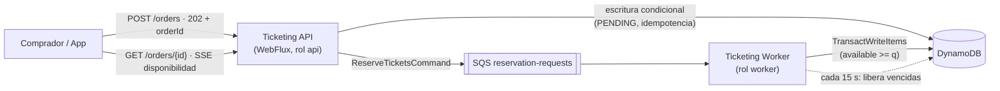

---

## 2. Análisis de requerimientos

Se siguió el proceso de **M6**: entender los requisitos, pensar cada componente, dividir en "rebanadas" y cuantificar los no funcionales.

### 2.1 Requisitos funcionales

| ID | Requisito | Interpretación de diseño | Caso de uso |
|---|---|---|---|
| **RF-01** | Gestión de eventos (crear y consultar; nombre, fecha, lugar, capacidad) | El evento se crea junto con su agregado `Inventory` en una sola transacción | `CreateEventUseCase`, `GetEventUseCase`, `ListEventsUseCase` |
| **RF-02** | Reserva temporal de máximo 10 minutos | Al procesar la orden, las entradas pasan de `AVAILABLE` a `RESERVED` con `expiresAt = now + 10 min` | `ReserveTicketsUseCase` |
| **RF-03** | Procesamiento asíncrono: encolar, devolver `orderId` y que un consumidor valide y actualice | La API persiste la orden en `PENDING`, publica `ReserveTicketsCommand` y responde `202`. El *worker* valida la disponibilidad real | `PlaceOrderUseCase` → `ReserveTicketsUseCase` |
| **RF-04** | Consulta del estado de la orden en cualquier momento | `GET /orders/{id}` devuelve `status` (ciclo de vida de la orden) y `ticketStatus` (uno de los 5 estados del enunciado). Ver ADR-009 | `GetOrderUseCase` |
| **RF-05** | Control de concurrencia sin sobreventa | Escrituras condicionales con la condición `available >= :q` y transacciones atómicas. Ver la sección 8 | Transversal |
| **RF-06** | Liberación automática periódica de reservas vencidas | Tarea programada que consulta el *sparse GSI* `deadline-index` y libera con transacciones condicionales idempotentes | `ReleaseExpiredReservationsUseCase` |
| **RF-07** | Disponibilidad en tiempo real considerando vendidas y reservadas | `GET /events/{id}/availability` con lectura consistente y `GET .../availability/stream` (Server-Sent Events) | `GetAvailabilityUseCase` |

**Rebanadas complementarias.** El enunciado define los estados `PENDING_CONFIRMATION`, `SOLD` y `COMPLIMENTARY` pero no dice cómo se llega a ellos. Para que la máquina de estados quede completa se agregan:

| ID | Requisito derivado | Justificación |
|---|---|---|
| **RF-08** | Confirmar la compra (`POST /orders/{id}/confirm`), que pasa de `RESERVED` a `PENDING_CONFIRMATION` y, tras el pago asíncrono, a `SOLD` | Sin confirmación la reserva siempre vencería y nada llegaría a `SOLD` |
| **RF-09** | Emitir cortesías (`POST /events/{id}/complimentary-tickets`, solo administradores), que pasa de `AVAILABLE` a `COMPLIMENTARY` | Es el único camino al estado `COMPLIMENTARY`, que es final y no contable |
| **RF-10** | Cancelación voluntaria de una reserva (`POST /orders/{id}/cancel`) | Devuelve el inventario antes de los 10 minutos. Opcional y de bajo costo |

### 2.2 Reglas de negocio del enunciado

| Regla | Cómo se garantiza |
|---|---|
| Cada entrada tiene un solo estado a la vez | La entidad `Ticket` tiene un único atributo `status`. Cada transición es una actualización condicional `status = :expected` |
| Las transiciones son atómicas y auditables | Cada transición es una sola `TransactWriteItems` que incluye un registro de auditoría *append-only* en la tabla `ticket-audit` |
| `RESERVED` y `PENDING_CONFIRMATION` no son ventas | Tienen contadores propios (`reserved`, `pendingConfirmation`) separados de `sold`. Los reportes contables solo suman `sold` |
| `SOLD` es final e irreversible | El enum `TicketStatus.SOLD` no tiene transiciones salientes. El dominio lanza `InvalidStateTransitionException` y la base rechaza la operación por condición |
| `COMPLIMENTARY` es final y no contable | No tiene transiciones salientes, tiene su propio contador y queda fuera de los reportes de ingresos |

### 2.3 Requisitos técnicos y cómo se cumplen

| Requisito técnico | Cumplimiento |
|---|---|
| Java 25 (Records, Pattern Matching, Virtual Threads si aplica) | Records para *value objects*, comandos y DTOs. *Sealed interfaces* con `switch` exhaustivo para resultados de dominio. Variables sin nombre (`_`). Cuerpos de constructor flexibles para validar. **Virtual Threads no aplica en la ruta de petición**, porque WebFlux es no bloqueante sobre *event loop* (ver ADR-001) |
| Spring Boot 4.x + WebFlux | API 100 % reactiva: `Mono` y `Flux` de punta a punta, sin `block()` |
| Base de datos | DynamoDB (DynamoDB Local en desarrollo) con el cliente asíncrono del AWS SDK v2 |
| Cola de mensajes, *at-least-once* | SQS Standard (LocalStack en desarrollo), DLQ y consumidor idempotente |
| *Optimistic locking* o *conditional writes* | Ambos: escrituras condicionales sobre contadores y atributo `version` en `Order` |
| Docker y `docker-compose.yml` | Compose con DynamoDB Local, LocalStack, un contenedor de inicialización, `api` y `worker` |
| Clean Architecture (Domain, Use Cases, Infrastructure) | Proyecto Maven multimódulo con la regla de dependencias verificada por ArchUnit |
| Pruebas con cobertura ≥ 90 % | JUnit 5, Mockito, reactor-test y WebTestClient, con *quality gate* de JaCoCo en el build |

---

## 3. Atributos de calidad y trade-offs

### 3.1 Atributos priorizados (ISO/IEC 25010) [M3]

| Prioridad | Atributo (ISO 25010) | Por qué es crítico aquí |
|---|---|---|
| 1 | **Seguridad → Integridad** | La sobreventa es el defecto de negocio más grave |
| 2 | **Rendimiento → Comportamiento temporal y capacidad** | Miles de compras simultáneas en cada apertura de ventas |
| 3 | **Fiabilidad → Disponibilidad y tolerancia a fallos** | Una caída durante una apertura de ventas significa pérdida directa de ingresos |
| 4 | **Escalabilidad** (capacidad) | La carga es de picos: casi nula entre aperturas y extrema durante ellas |
| 5 | **Seguridad → Confidencialidad, no repudio y responsabilidad** | Hay datos de clientes, se requiere auditoría de transiciones y existe abuso por bots |
| 6 | **Mantenibilidad → Modificabilidad y capacidad de prueba** | Hay que cambiar de infraestructura sin tocar el dominio y la prueba exige ≥ 90 % de cobertura |

### 3.2 Árbol de utilidad [M3][M4]

Cada hoja lleva **(Importancia para el negocio, Dificultad técnica)** con valores H, M o L.

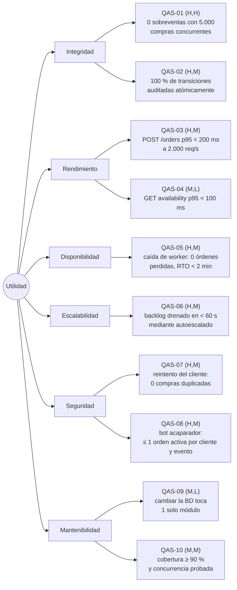

### 3.3 Escenarios de calidad (formato de 6 partes) [M3]

> Las cifras son **metas de diseño** que se validan con pruebas de carga (k6 o Gatling). No son mediciones ya realizadas. Ver la sección 22.

**QAS-01 — Integridad: no sobreventa**

| Parte | Valor |
|---|---|
| Fuente | 5.000 compradores concurrentes |
| Estímulo | Solicitudes simultáneas de compra para las últimas 100 entradas de un evento |
| Ambiente | Operación pico, varios *workers* consumiendo en paralelo |
| Artefacto | `ReserveTicketsUseCase` y el ítem `inventory` en DynamoDB |
| Respuesta | Exactamente las órdenes que caben quedan `RESERVED`; las demás quedan `REJECTED (SOLD_OUT)` |
| Medida | `available + reserved + pendingConfirmation + sold + complimentary == totalCapacity` en todo momento y `sold + reserved + pendingConfirmation + complimentary ≤ totalCapacity`. **Sobreventas = 0** |

**QAS-03 — Rendimiento: admisión de compras**

| Parte | Valor |
|---|---|
| Fuente | Tráfico de una apertura de ventas |
| Estímulo | 2.000 `POST /orders` por segundo durante 5 minutos |
| Ambiente | Carga pico con autoescalado activo |
| Artefacto | Ticketing API |
| Respuesta | Persiste la orden en `PENDING`, la encola y responde `202` sin esperar el procesamiento |
| Medida | p95 < 200 ms, p99 < 500 ms y tasa de errores 5xx < 0,1 % |

**QAS-05 — Disponibilidad: falla de un worker**

| Parte | Valor |
|---|---|
| Fuente | Falla de infraestructura |
| Estímulo | Un *worker* muere mientras procesa un mensaje |
| Ambiente | Operación normal |
| Artefacto | Consumidor de SQS |
| Respuesta | El mensaje no se borró, así que reaparece tras el *visibility timeout* y otro *worker* lo procesa. La guarda de estado evita un efecto doble. ECS reemplaza la tarea |
| Medida | 0 órdenes perdidas, 0 efectos duplicados y reprocesamiento en < 2 min |

**QAS-06 — Escalabilidad: drenado del backlog**

| Parte | Valor |
|---|---|
| Fuente | Pico de demanda |
| Estímulo | Más de 10.000 mensajes visibles en `reservation-requests` |
| Ambiente | Pico |
| Artefacto | Servicio ECS `worker` |
| Respuesta | El escalado automático por *backlog per task* agrega tareas |
| Medida | `ApproximateAgeOfOldestMessage` < 60 s |

**QAS-07 — Seguridad e idempotencia: reintentos**

| Parte | Valor |
|---|---|
| Fuente | Cliente legítimo con una red inestable, o un atacante que repite peticiones |
| Estímulo | Reenvía `POST /orders` con la misma `Idempotency-Key` |
| Ambiente | Cualquiera |
| Artefacto | `PlaceOrderUseCase` y la tabla `idempotency-keys` |
| Respuesta | Devuelve la misma respuesta (mismo `orderId`). Si la clave se reutiliza con otro *payload* responde `422` |
| Medida | **Compras duplicadas = 0** |

**QAS-08 — Seguridad: abuso de recursos (acaparamiento)**

| Parte | Valor |
|---|---|
| Fuente | Bot o revendedor |
| Estímulo | Intenta reservar todo el inventario con muchas órdenes que nunca paga |
| Ambiente | Apertura de ventas |
| Artefacto | Filtro de *rate limiting*, `PlaceOrderUseCase` y el ítem *guard* |
| Respuesta | Máximo 10 entradas por orden y una orden activa por cliente y evento (`409`). Exceso de peticiones: `429`. Además, WAF con reglas por tasa |
| Medida | Entradas retenidas por un cliente ≤ 10 por evento |

**QAS-02** (auditoría), **QAS-04** (lectura de disponibilidad), **QAS-09** (modificabilidad) y **QAS-10** (capacidad de prueba) siguen el mismo formato y se resumen en la matriz de la sección 23.

### 3.4 Trade-offs explícitos [M3][M4]

| # | Tensión | Decisión | Lo que se sacrifica | Mitigación |
|---|---|---|---|---|
| T1 | **Consistencia vs. disponibilidad** (CAP) | Inventario **CP**: escrituras condicionales con consistencia fuerte. Catálogo de eventos **AP**: lecturas eventualmente consistentes y caché | Una escritura sobre el inventario puede fallar en lugar de "aceptar y reconciliar" | Reintento con *backoff* en conflictos transitorios y rechazo claro (`SOLD_OUT`) si no hay cupo |
| T2 | **Latencia percibida vs. certeza** | La API responde `202` antes de saber si hay cupo | El usuario no conoce el resultado al instante | Rechazo rápido (*fast-fail*) si ya está agotado, *polling* con `Retry-After` y SSE |
| T3 | **At-least-once vs. simplicidad** | SQS Standard (lo exige la prueba) | Los mensajes pueden llegar duplicados o desordenados | Consumidor idempotente: la guarda de estado y la versión hacen que repetir no tenga efecto |
| T4 | **Rendimiento vs. costo** | Transacciones DynamoDB (2 WCU por ítem) | El doble de capacidad de escritura | Solo en transiciones de estado; las lecturas son simples |
| T5 | **Contadores vs. entradas individuales** | Contadores para control de concurrencia y entidad `Ticket` para trazabilidad | Se hacen más escrituras por transición | Máximo 10 entradas por orden, así que una transacción tiene ≤ 14 ítems (el límite es 100) |
| T6 | **Granularidad: microservicios vs. modular** | Un *bounded context* y una imagen con 2 roles | No hay despliegue independiente por subdominio | Los módulos internos están listos para separarse (ver la sección 22) |
| T7 | **Ítem caliente vs. simplicidad** | Un ítem de inventario por evento (1 *shard*) | Techo de unas 1.000 WCU/s por ítem en DynamoDB | Diseño de *sharding* documentado y sala de espera virtual (sección 22) |
| T8 | **Dependencia de AWS vs. velocidad** [M12] | Servicios administrados (DynamoDB, SQS) | *Vendor lock-in* | Puertos y adaptadores: cambiar de proveedor solo toca `driven-adapters` |

---

## 4. Modelado arquitectónico C4

Modelo C4 en los niveles 1 a 3 [M15]. La vista física (*deployment*) del modelo 4+1 está en la sección 16.

### 4.1 Nivel 1 — Contexto del sistema

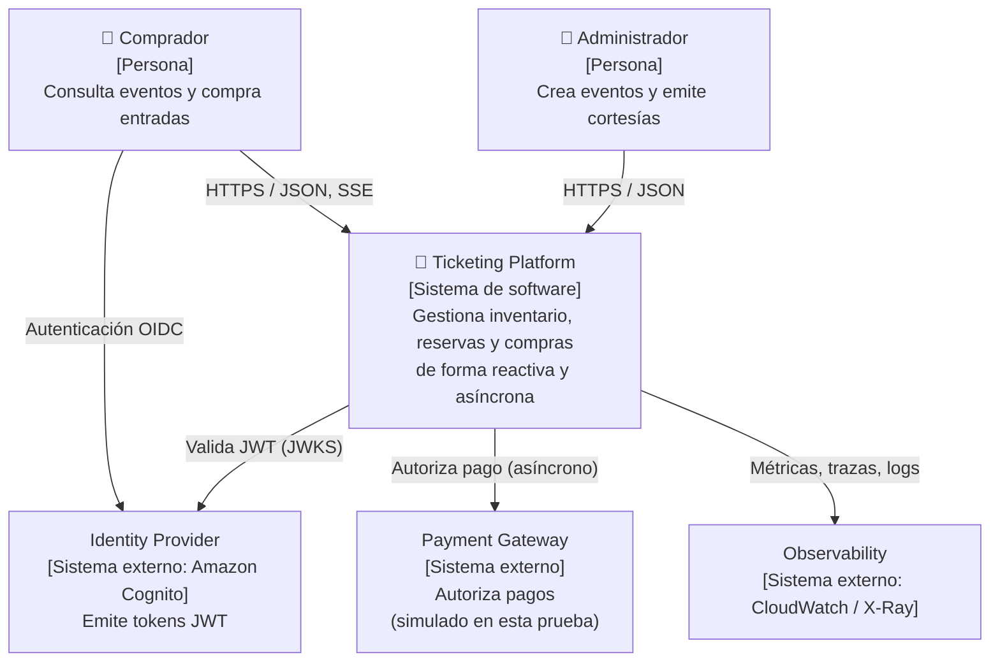

### 4.2 Nivel 2 — Contenedores

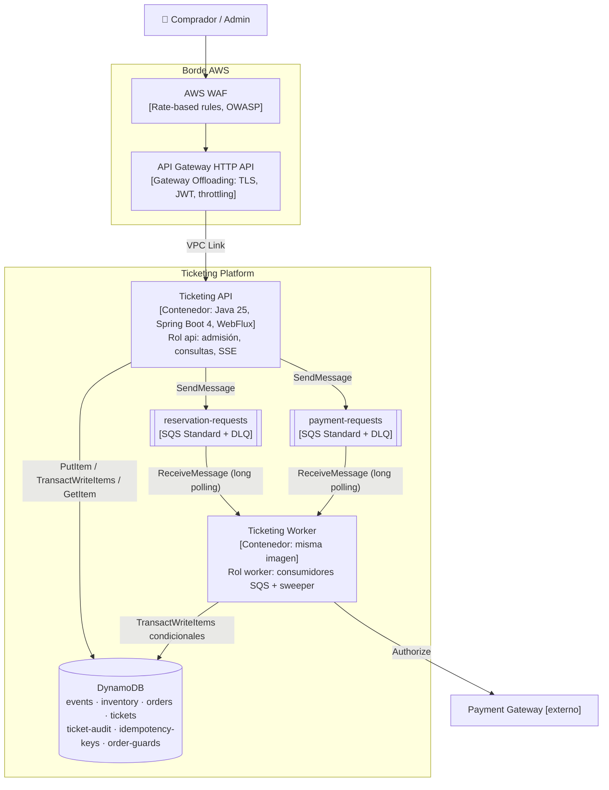

| Contenedor | Responsabilidad | Escala por | Tecnología |
|---|---|---|---|
| **Ticketing API** | Validar, autenticar, admitir órdenes, consultar, transmitir disponibilidad | CPU y peticiones por destino | Spring WebFlux sobre Netty |
| **Ticketing Worker** | Reservar, procesar pagos y liberar reservas vencidas | Mensajes visibles por tarea (*backlog per task*) | Cliente asíncrono de SQS (AWS SDK v2) y Reactor |
| **reservation-requests** | Amortiguar el pico de solicitudes de reserva | Escala sola | SQS Standard |
| **payment-requests** | Cola separada para clientes que ya están pagando (*Priority Queue* por aislamiento) | Escala sola | SQS Standard |
| **DynamoDB** | Fuente de verdad del inventario, las órdenes, las entradas y la auditoría | *On-demand* | DynamoDB con PITR y SSE-KMS |

### 4.3 Nivel 3 — Componentes

**Contenedor Ticketing API**

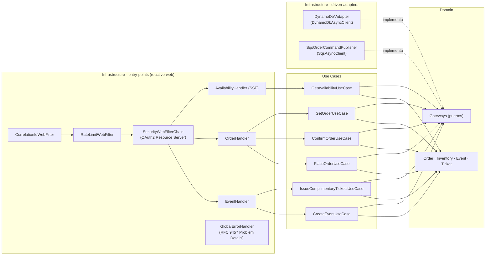

**Contenedor Ticketing Worker**

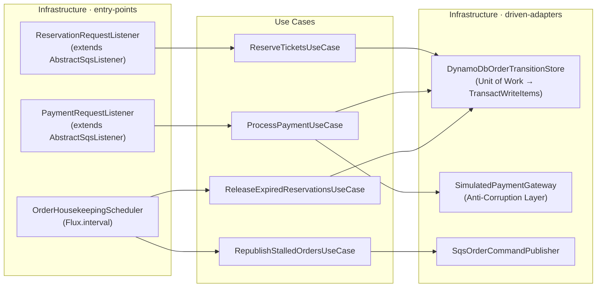

---

## 5. Diseño del dominio (DDD táctico)

### 5.1 Lenguaje ubicuo [M16]

| Término (código) | Significado acordado con negocio |
|---|---|
| `Event` | Espectáculo con nombre, fecha, lugar y capacidad total |
| `Inventory` | Distribución de la capacidad de un evento por estado de entrada. Es la **vista materializada** de los estados de las entradas |
| `Ticket` | Unidad vendible (admisión general). Tiene un único `TicketStatus` |
| `Order` | Intención de compra de un cliente por N entradas de un evento. Es la raíz del agregado y gobierna el proceso |
| `Reservation` | Retención temporal (10 min) de entradas asociada a una orden |
| `Hold` | Entradas retenidas pero no vendidas: `reserved + pendingConfirmation` |
| `Complimentary` | Cortesía. Entrada entregada sin venta, que no cuenta para los reportes contables |
| `Sweep` | Barrido periódico que libera reservas vencidas |

### 5.2 Subdominios y bounded contexts

| Subdominio | Tipo | En esta solución |
|---|---|---|
| **Inventory & Reservations** | **Core domain**, la ventaja competitiva | Se modela con más rigor: invariantes y concurrencia |
| **Ordering** | Core | Máquina de estados de la orden |
| **Event Catalog** | De soporte | CRUD simple |
| **Payments** | Genérico (se compra, no se construye) | Puerto `PaymentGateway` con una *Anti-Corruption Layer* |
| **Identity** | Genérico | Cognito |

Todos conviven en **un solo bounded context ("Ticketing")** y se separan en paquetes por subdominio. La razón está en ADR-001.

### 5.3 Agregados, entidades y value objects

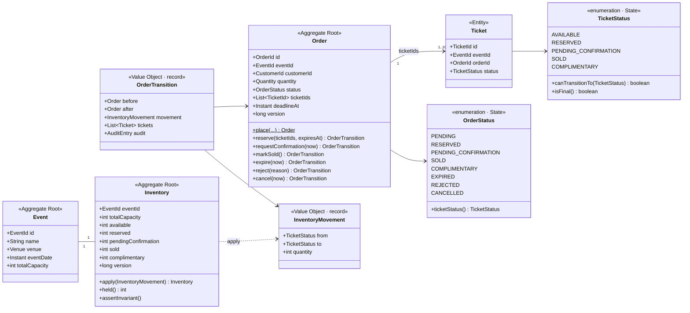

**Decisiones clave del modelo:**

1. **Value objects como `record`** con validación en el constructor (Java 25): `EventId`, `OrderId`, `TicketId`, `CustomerId` y `Quantity` (1 a 10). Son inmutables y se comparan por valor.
2. **Inmutabilidad del agregado.** Cada método de `Order` devuelve un `OrderTransition` (estado anterior, estado nuevo, movimiento de inventario, entradas afectadas y registro de auditoría). El dominio **decide** y el adaptador **persiste** de forma atómica. Así el dominio queda puro y fácil de probar.
3. **`InventoryMovement`** traduce una transición de entradas a un movimiento entre "cubetas" de contador. Por ejemplo, `AVAILABLE → RESERVED, q` se convierte en `available -= q; reserved += q`. Una sola regla del dominio produce la expresión condicional de DynamoDB y elimina la duplicación de lógica.
4. **Invariante del inventario**, que se verifica en el dominio y en las pruebas: `available + reserved + pendingConfirmation + sold + complimentary == totalCapacity`, con todos los contadores ≥ 0.
5. **Resultados de dominio con `sealed interface`.** `ReservationOutcome permits Reserved, Rejected, AlreadyProcessed`, consumido con `switch` exhaustivo y *record patterns* (Java 25), sin excepciones para el flujo normal.

### 5.4 Máquina de estados de la entrada (los 5 estados del enunciado)

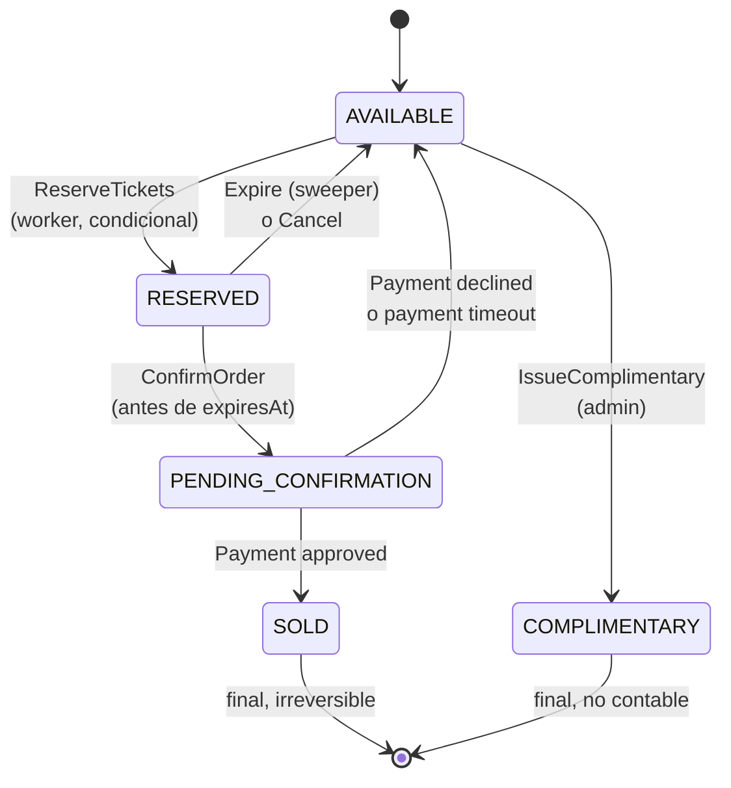

### 5.5 Máquina de estados de la orden (proceso)

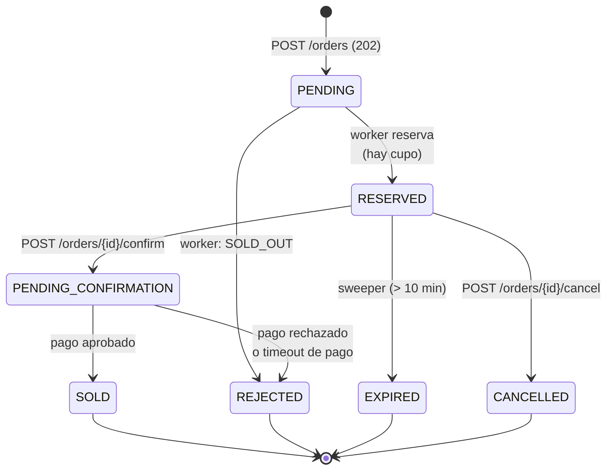

Las órdenes de cortesía nacen directamente en `COMPLIMENTARY`, que es final. La correspondencia entre `OrderStatus` y `ticketStatus` (el estado que exige RF-04) está en ADR-009.

---

## 6. Estructura Clean Architecture y SOLID

### 6.1 Capas y regla de dependencias [M15][M21]

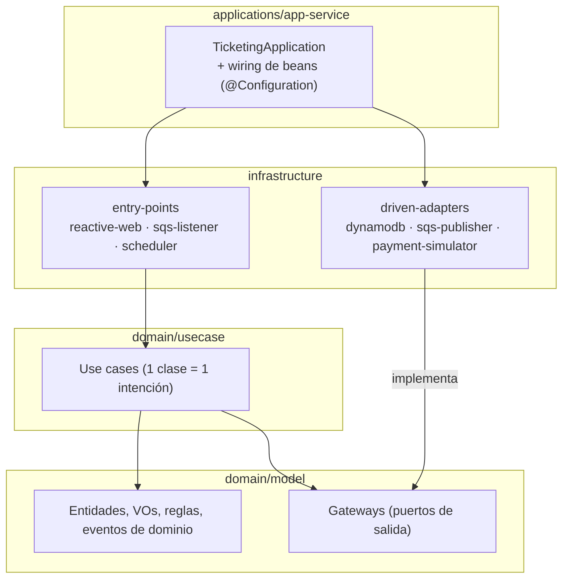

**Regla:** las dependencias siempre apuntan hacia el centro. `domain/model` no depende de Spring, del AWS SDK ni de Jackson; su única dependencia es **reactor-core**, que se usa como primitiva asíncrona (`Mono` y `Flux`) en la firma de los puertos. Esto se **verifica en el build** con ArchUnit y, además, con la separación en módulos Maven: lo que no está declarado como dependencia no compila.

### 6.2 Estructura del repositorio

```text
reactive-ticketing-platform/
├── domain/
│   ├── model/                         # co.ticketing.model
│   │   ├── event/        Event, EventId, Venue, gateways/EventRepository
│   │   ├── inventory/    Inventory, InventoryMovement, gateways/InventoryRepository
│   │   ├── order/        Order, OrderId, OrderStatus (tabla del flujo), OrderTransition, OrderPolicy,
│   │   │                 Quantity, CommitResult, AdmissionResult, OrderCommand (sealed),
│   │   │                 gateways/{OrderRepository, OrderTransitionStore, OrderAdmissionStore, OrderCommandPublisher}
│   │   ├── ticket/       Ticket, TicketId, TicketStatus
│   │   ├── payment/      PaymentRequest, PaymentResult (sealed), gateways/PaymentGateway
│   │   ├── idempotency/  IdempotencyKey, IdempotencyRecord, RequestFingerprint, gateways/IdempotencyStore
│   │   ├── audit/        AuditEntry
│   │   └── common/       CustomerId, Page, IdGenerator, Validations, exception/ (DomainException sealed)
│   └── usecase/                       # co.ticketing.usecase
│       ├── event/        CreateEventUseCase, GetEventUseCase, ListEventsUseCase
│       ├── availability/ GetAvailabilityUseCase
│       ├── order/        PlaceOrderUseCase, ReserveTicketsUseCase, ConfirmOrderUseCase,
│       │                 ProcessPaymentUseCase, CancelOrderUseCase, GetOrderUseCase
│       ├── complimentary/IssueComplimentaryTicketsUseCase
│       └── housekeeping/ ReleaseExpiredReservationsUseCase, RepublishStalledOrdersUseCase
├── infrastructure/
│   ├── driven-adapters/
│   │   ├── dynamodb-repository/       # Adaptadores DynamoDbAsyncClient + mappers
│   │   ├── sqs-publisher/             # SqsAsyncClient + retry/circuit breaker
│   │   └── payment-simulator/         # Implementación ACL del PaymentGateway
│   ├── helpers/
│   │   └── command-messages/          # Contrato JSON de los comandos SQS (compartido publisher/listener)
│   └── entry-points/
│       ├── reactive-web/              # Router functions, handlers, DTOs, filtros, seguridad
│       ├── sqs-listener/              # AbstractSqsListener (Template Method) + listeners
│       └── scheduler/                 # OrderHousekeepingScheduler
├── applications/
│   └── app-service/                   # main, configuración, perfiles api|worker|local
├── deployment/
│   ├── Dockerfile
│   └── local/init-aws.sh              # creación de tablas y colas (LocalStack/DynamoDB Local)
├── infra/terraform/                   # IaC (sección 16)
├── postman/ticketing.postman_collection.json
├── docs/ARCHITECTURE.md               # este documento
├── docker-compose.yml
└── README.md
```

La estructura sigue la convención *scaffold* de Clean Architecture muy usada en el ecosistema Java de Colombia (`model`, `usecase`, `driven-adapters`, `entry-points`, `app-service`). Coincide con las tres capas que pide la prueba (Domain, Use Cases, Infrastructure) más un módulo de arranque.

### 6.3 Aplicación de SOLID [M5][M2]

| Principio | Dónde y cómo se aplica | Ejemplo concreto |
|---|---|---|
| **S** — Responsabilidad única | Cada caso de uso tiene una sola intención y cada adaptador una sola tecnología | `PlaceOrderUseCase` solo admite órdenes; `ReserveTicketsUseCase` solo reserva. `DynamoDbOrderTransitionStore` solo traduce `OrderTransition` a `TransactWriteItems` |
| **O** — Abierto/cerrado | Se agregan comportamientos sin modificar lo existente | Nuevo medio de pago: otra implementación de `PaymentGateway`. Nueva cola: otra subclase de `AbstractSqsListener` |
| **L** — Sustitución de Liskov | Cualquier implementación de un puerto respeta su contrato, incluidos los errores | `InMemoryOrderTransitionStore` (pruebas de concurrencia) y `DynamoDbOrderTransitionStore` producen los mismos `ReservationOutcome` ante el mismo escenario. Se verifica con pruebas de contrato compartidas |
| **I** — Segregación de interfaces | Puertos pequeños y específicos | `OrderRepository` (lectura), `OrderTransitionStore` (escritura atómica) y `OrderCommandPublisher` (mensajería) están separados. El *sweeper* no ve métodos de publicación que no usa |
| **D** — Inversión de dependencias | Los casos de uso dependen de abstracciones del dominio y la infraestructura las implementa | `ReserveTicketsUseCase(OrderRepository, OrderTransitionStore, IdGenerator, Clock)` no conoce DynamoDB. El *wiring* está en `app-service` |

### 6.4 Uso de Java 25

| Característica | Uso |
|---|---|
| `record` | Value objects, comandos (`ReserveTicketsCommand`), DTOs de la API y eventos de dominio |
| `sealed interface` + `switch` exhaustivo | `ReservationOutcome`, `PaymentResult` (`Approved` / `Declined`) y `DomainException`. El compilador avisa si falta un caso |
| *Record patterns* | `case Rejected(var reason) -> ...` en los manejadores |
| Variables sin nombre `_` | `catch (ConditionalCheckFailedException _)` y lambdas que ignoran parámetros |
| Cuerpos de constructor flexibles (JEP 513) | Validar argumentos antes de `this(...)` en los value objects |
| Virtual Threads | **No se usan en la ruta reactiva** (ver ADR-001). Mezclarlos con WebFlux no aporta y complica el modelo de concurrencia |

### 6.5 Programación funcional: mónadas y lambdas [J13][J14][J15]

Esta guía valida los conceptos de *Learn Java 17 Programming* (capítulo 13, Programación funcional; capítulo 14, Streams; capítulo 15, Programación reactiva) y los aterriza en el proyecto. El libro **no usa el término "mónada"**, pero sí trabaja con los tipos que lo son. Además, enseña reactividad con **RxJava** y este proyecto usa **Project Reactor** (el que exige Spring WebFlux), así que se indica la equivalencia en cada caso.

#### 6.5.1 ¿Qué es una mónada y por qué importa aquí?

Una **mónada** es un tipo contenedor `M<T>` que tiene:

1. **`unit`**, que envuelve un valor: `Optional.of(x)`, `Stream.of(x)`, `Mono.just(x)`.
2. **`flatMap`**, que encadena una función que devuelve otro `M<R>` **sin anidar** contenedores (`M<M<R>>` → `M<R>`).

Además debe cumplir tres leyes, que son las que permiten refactorizar una cadena sin cambiar su comportamiento:

| Ley | Enunciado (con `Mono`) | Consecuencia práctica |
|---|---|---|
| Identidad izquierda | `Mono.just(a).flatMap(f)` ≡ `f.apply(a)` | Envolver y luego encadenar no agrega comportamiento |
| Identidad derecha | `m.flatMap(Mono::just)` ≡ `m` | Un `flatMap` que solo re-envuelve sobra |
| Asociatividad | `m.flatMap(f).flatMap(g)` ≡ `m.flatMap(x -> f.apply(x).flatMap(g))` | Se pueden extraer subcadenas a métodos privados sin cambiar el resultado |

`map` (aplicar una función pura dentro del contenedor) convierte a estos tipos en **funtores**. El libro muestra `flatMap` en `Stream` como la operación que "aplana" un `Stream<Stream<R>>` en `Stream<R>` [J14, p. 544 y 554]. Esa es exactamente la operación monádica.

#### 6.5.2 Tipos monádicos del proyecto y cuándo usar cada uno

| Tipo | Semántica | Capítulo del libro | Uso en este proyecto |
|---|---|---|---|
| `Optional<T>` | 0 o 1 valor, **síncrono** | [J14] (`findFirst`, `min`, `max`) y [J15] (`average().orElse(0)`) | Solo dentro del **dominio puro y síncrono**, por ejemplo `Order.expiresAt()` devuelve `Optional<Instant>` porque solo existe en `RESERVED`. **Nunca** como campo, parámetro ni dentro de un `Mono` (`Mono<Optional<T>>` está prohibido: se usa `Mono.empty()`) |
| `Stream<T>` | N valores, *pull*, perezoso y de un solo uso | [J14] | Transformaciones **en memoria** y acotadas: mapear las 1 a 10 entradas de una orden o construir la lista de `TransactWriteItem`. Nunca para E/S |
| `CompletableFuture<T>` | 1 valor asíncrono, **ansioso** (*eager*) | [J15, p. 599] | No se usa directamente. Es lo que devuelven los clientes asíncronos del AWS SDK v2 y **siempre** se envuelve en `Mono` de forma perezosa (ver la regla R1) |
| **`Mono<T>`** | 0 o 1 valor asíncrono, **perezoso** (*cold*) y con error | ≈ `Single`/`Maybe` de RxJava [J15, p. 609-610] | Toda operación de E/S de un solo resultado: puertos de repositorio, casos de uso y *handlers*. `Mono<Void>` ≈ `Completable` |
| **`Flux<T>`** | 0 a N valores asíncronos con *backpressure* | ≈ `Flowable` de RxJava [J15, p. 609] | Listados paginados, el SSE de disponibilidad, el *sweeper* y el ciclo de consumo de SQS |
| `ReservationOutcome`, `PaymentResult` (`sealed`) | Resultado de negocio como **valor** (un "Either" con nombre del dominio) | Clases y *records* sellados [J2, p. 103-109] | Rechazos esperados (`SOLD_OUT`, `AlreadyProcessed`) que **no son errores técnicos** |

**Dos canales de error, con criterios distintos:**

- **Error técnico** (*timeout*, *throttling*, red): va por el canal de error de `Mono` (`Mono.error`) y lo manejan `retryWhen`, `onErrorResume` o el `GlobalErrorHandler`.
- **Resultado de negocio** (sin cupo, duplicado, reserva vencida): es un **valor** `sealed` que se consume con `switch` exhaustivo. No se usan excepciones como control de flujo.

No se agrega una librería de mónadas genérica (Vavr `Either`/`Try`). Los `sealed` con nombres del lenguaje ubicuo [M16] comunican mejor el dominio y el compilador verifica que todos los casos estén cubiertos.

#### 6.5.3 Reglas obligatorias para mónadas y lambdas

| # | Regla | Fundamento |
|---|---|---|
| **R1** | **Perezosa siempre:** `Mono.fromFuture(() -> client.call(req))`, nunca `Mono.fromFuture(client.call(req))` | `CompletableFuture` es ansioso [J15]: si se crea fuera del `Supplier`, la llamada ya salió y **`retryWhen` reintenta sobre un futuro ya terminado**, sin volver a llamar. Con el `Supplier`, cada resuscripción repite la llamada real |
| **R2** | **Cero bloqueos:** prohibido `block()`, `blockFirst()`, `toFuture().get()` y `Thread.sleep` en código de producción | El libro advierte que los operadores `blocking*` solo se usan "cuando no es posible" evitarlos [J15, p. 613]. En WebFlux, un bloqueo detiene el *event loop* de Netty |
| **R3** | **Lambdas puras en `map`, `filter` y `flatMap`:** el resultado depende solo de la entrada | "La función no tiene estado… su resultado depende solo de los datos de entrada" [J13, p. 516]. Los efectos secundarios (logs, métricas) van solo en `doOnNext`, `doOnError` y `doFinally` |
| **R4** | **Nada de estado mutable compartido dentro de lambdas.** Se prohíbe el "truco" del libro de mutar una `List` externa desde la lambda | El propio libro advierte del "peligro de efectos secundarios inesperados si la lambda se ejecuta en otro contexto" [J13, p. 533], y en Reactor cada operador puede ejecutarse en otro hilo. Se usan `collectList()`, `reduce()` o `scan()` |
| **R5** | **Interfaces funcionales estándar antes que propias:** `Function`, `Predicate`, `Supplier`, `Consumer`, `UnaryOperator` y `BiFunction` | El paquete `java.util.function` ya tiene 43 interfaces y los demás programadores las reconocen [J13, p. 520] |
| **R6** | **Puertos de un solo método con `@FunctionalInterface`** (`IdGenerator`, `PaymentGateway`) | El compilador garantiza que siga siendo funcional [J13, p. 518] y en las pruebas se sustituye con una lambda: `IdGenerator ids = () -> "order-1";` |
| **R7** | **Lambdas cortas:** si pasan de unas 3 líneas se extraen a un método privado con nombre y se usa una referencia a método (`this::reserve`) | "Cuando la implementación crece más allá de varias líneas… puede oscurecer la estructura" [J13, p. 535] |
| **R8** | **`Optional` sin `get()`:** se usan `map`, `filter`, `orElseThrow(Supplier)` u `or()` | El libro usa `result.get()` en sus ejemplos [J14, p. 563]. Eso **no** se replica: lanza `NoSuchElementException` si está vacío |
| **R9** | **`peek`/`doOnNext` solo para depurar u observar**, nunca para lógica | El libro lo define como operación "para depuración" [J14, p. 557] |
| **R10** | **Sin `parallelStream()` ni `CompletableFuture.supplyAsync()`** dentro del flujo reactivo | La concurrencia la controla Reactor con `flatMap(fn, concurrency)` (*bulkhead*). Los *streams* paralelos usan el *ForkJoinPool* común, fuera del control del *scheduler* [J15, p. 597] |
| **R11** | **Errores con operadores, no con `try/catch` + `printStackTrace()` en lambdas** | Se usan `onErrorMap` (traducir errores del SDK al dominio), `onErrorResume` y `retryWhen`. Los ejemplos con `ex.printStackTrace()` del libro son didácticos |
| **R12** | **Variables capturadas efectivamente finales** y `this` entendido como la instancia que encierra la lambda | Es la restricción del lenguaje que el libro explica [J13, p. 532-534]. Por eso los casos de uso no tienen campos mutables, solo dependencias `final` |

#### 6.5.4 Equivalencias de RxJava (el libro) a Reactor (el proyecto)

| Concepto del libro (RxJava) [J15] | En Reactor (proyecto) | Nota |
|---|---|---|
| `Single<T>` / `Maybe<T>` | `Mono<T>` | `Mono` cubre ambos casos: puede estar vacío |
| `Completable` | `Mono<Void>` | Por ejemplo `OrderCommandPublisher.publish(...)` |
| `Flowable<T>` (con *backpressure*) | `Flux<T>` | `Flux` siempre soporta *backpressure* |
| `Observable<T>` (sin *backpressure*) | — | No se usa |
| `blockingGet()`, `blockingLast()` | `block()` | **Prohibido** (R2). En pruebas se usa `StepVerifier` |
| *Cold observable* (`interval`) | `Flux.interval(...)`, `Mono.defer(...)` | El SSE es *cold* por suscriptor con micro-caché compartida |
| *Hot observable* (`publish().connect()`) | `Sinks.many().multicast()` o `.share()` | Evolución del SSE con *fan-out* (sección 22) |
| `subscribeOn` / `observeOn` | `subscribeOn` / `publishOn` | Casi nunca son necesarios: el AWS SDK v2 ya es no bloqueante |
| `Schedulers.io()` | `Schedulers.boundedElastic()` | Solo si apareciera una dependencia bloqueante inevitable |
| `Flow.Publisher` / `Flow.Subscriber` (JDK 9) | `Publisher` de Reactive Streams | Reactor implementa la misma especificación con *backpressure* no bloqueante [J15, p. 605] |

#### 6.5.5 Ejemplos aplicados al proyecto

**1. Adaptador DynamoDB: mónada perezosa (R1) y traducción de errores (R11)**

```java
public Mono<Inventory> findByEventId(EventId eventId) {
    return Mono.fromFuture(() -> dynamoDb.getItem(getInventoryRequest(eventId))) // lazy: re-executed on retry
            .filter(GetItemResponse::hasItem)                                   // empty if not found
            .map(response -> InventoryItemMapper.toDomain(response.item()))     // pure function
            .onErrorMap(SdkException.class, PersistenceUnavailableException::new);
}
```

**2. Caso de uso como cadena monádica de `flatMap`**

```java
public Mono<PlaceOrderResult> execute(PlaceOrderCommand command) {
    return idempotencyStore.find(scopedKey)
            .flatMap(existing -> replay(existing, fingerprint))                       // retry of a known request
            .switchIfEmpty(Mono.defer(() -> admitNew(command, scopedKey, fingerprint)));
}

private Mono<PlaceOrderResult> admitNew(PlaceOrderCommand command, String scopedKey, String fingerprint) {
    Instant now = clock.instant();
    return Mono.zip(requireOnSaleEvent(command.eventId(), now),                     // independent reads
                    requireInventory(command.eventId()))                            // run in parallel (Mono.zip)
            .flatMap(tuple -> admit(command, tuple.getT2(), scopedKey, fingerprint, now))
            .flatMap(result -> onAdmission(result, fingerprint));                   // method reference style (R7)
}
```

Dos ideas clave: `flatMap` encadena pasos **dependientes** (el resultado de uno alimenta al siguiente) y `Mono.zip` ejecuta en paralelo lecturas **independientes** (evento e inventario), ahorrando un viaje de red completo. Por la ley de asociatividad, extraer `admitNew` y `onAdmission` a métodos privados no cambia el comportamiento de la cadena.

**3. Resultado de negocio como valor `sealed` con `switch` exhaustivo (Java 25)**

```java
public sealed interface ReservationOutcome {
    record Reserved(Order order) implements ReservationOutcome {}
    record Rejected(OrderId orderId, RejectionReason reason) implements ReservationOutcome {}
    record AlreadyProcessed(OrderId orderId) implements ReservationOutcome {}
}

private Mono<Void> record(ReservationOutcome outcome) {
    return switch (outcome) {                       // the compiler forces every case to be handled
        case Reserved(var order)        -> metrics.reserved(order.eventId());
        case Rejected(_, var reason)    -> metrics.rejected(reason);
        case AlreadyProcessed(_)        -> metrics.duplicate();
    };
}
```

**4. Composición de funciones: política de reintento reutilizable (*Decorator* + `Function`)**

Igual que `andThen`/`compose` del libro [J13, p. 529], un operador de Reactor es un `Function<Mono<T>, Mono<T>>` que se aplica con `transform`:

```java
public final class RetryPolicies {
    public static <T> Function<Mono<T>, Mono<T>> onTransientConflict() {
        return mono -> mono.retryWhen(Retry.backoff(3, Duration.ofMillis(50))
                .maxBackoff(Duration.ofMillis(400))
                .jitter(0.5)
                .filter(TransientConflictException.class::isInstance));
    }
}

// Uso: transitionStore.commit(transition).transform(RetryPolicies.onTransientConflict());
```

**5. Composición de `Predicate` para reglas de negocio [J13, p. 525-527]**

```java
Predicate<Order> confirmable = OrderRules.isReserved()
        .and(OrderRules.notExpiredAt(clock.instant()))
        .and(OrderRules.ownedBy(customerId));
```

**6. Prueba que demuestra la regla R1 (pereza y reintento)**

```java
@Test
void retryReExecutesTheDynamoDbCall() {
    when(dynamoDb.transactWriteItems(any(TransactWriteItemsRequest.class)))
            .thenReturn(CompletableFuture.failedFuture(transactionConflict()))
            .thenReturn(CompletableFuture.completedFuture(TransactWriteItemsResponse.builder().build()));

    StepVerifier.withVirtualTime(() -> store.commit(transition)
                    .transform(RetryPolicies.onTransientConflict()))
            .thenAwait(Duration.ofSeconds(1))
            .verifyComplete();

    verify(dynamoDb, times(2)).transactWriteItems(any(TransactWriteItemsRequest.class)); // real second call
}
```

#### 6.5.6 Cómo se verifican estas reglas

| Regla | Verificación automática |
|---|---|
| R1, R2, R11 | Pruebas con `StepVerifier` y `verify(times(n))` (ejemplo 6). Opcional: **BlockHound** en las pruebas para detectar llamadas bloqueantes en hilos de Reactor |
| R2, R10 | **ArchUnit**: ninguna clase de `..usecase..`, `..entrypoints..` ni `..adapters..` puede llamar a `Mono.block*`, `Flux.block*`, `Thread.sleep`, `Collection.parallelStream` ni `CompletableFuture.supplyAsync` |
| R4, R12 | ArchUnit: los campos de clases `*UseCase` deben ser `final` |
| R8 | Regla de análisis estático (Sonar `java:S3655`, *Optional value should only be accessed after calling isPresent()*) |
| R3, R9 | Revisión de código (*Definition of Done*, [M21]) |

---

## 7. Flujos principales (vista de procesos)

### 7.0 Modelo de ejecución: síncrono, asíncrono y reactivo

El ejercicio combina **procesamiento síncrono y asíncrono** sobre una **librería reactiva (Spring WebFlux / Project Reactor)**. Son tres ejes independientes y conviene no confundirlos:

| Eje | Pregunta que responde | Opciones |
|---|---|---|
| **Comunicación** | ¿El cliente recibe el **resultado final** en la misma respuesta HTTP? | **Síncrona**: sí. **Asíncrona**: recibe un acuse (`202` + `orderId`) y el trabajo continúa después, en otro proceso, vía SQS |
| **Ejecución** | ¿Un hilo queda **detenido esperando** la E/S? | **Bloqueante**: sí (modelo un hilo por petición). **No bloqueante**: el hilo de Netty se libera mientras DynamoDB o SQS responden y se retoma con el resultado [J15] |
| **Modelo de programación** | ¿Cómo se expresa el flujo? | **Imperativo** o **reactivo** (`Mono`/`Flux`, composición declarativa y *backpressure*) |

**En este sistema:** toda la E/S es **no bloqueante y reactiva** (WebFlux, AWS SDK v2 asíncrono y Reactor), tanto en las operaciones síncronas como en las asíncronas. Una petición síncrona en WebFlux no bloquea hilos: el cliente espera, pero el servidor no. El código **síncrono puro** existe solo dentro del dominio (reglas, transiciones de estado, `Optional`/`Stream`), que no hace E/S.

#### 7.0.1 Clasificación de cada operación

| Operación | Comunicación | Ejecución | Tipo reactivo | Por qué este modo |
|---|---|---|---|---|
| `POST /events` | **Síncrona** (`201` con el recurso) | No bloqueante | `Mono<EventResponse>` | Operación de administración, de bajo volumen y sin contención |
| `GET /events` | **Síncrona** | No bloqueante | `Flux<EventResponse>` | Consulta paginada; el `Flux` aplica *backpressure* al escribir la respuesta |
| `GET /events/{id}` | **Síncrona** | No bloqueante | `Mono<EventResponse>` | Lectura por clave |
| `GET /events/{id}/availability` | **Síncrona** | No bloqueante | `Mono<AvailabilityResponse>` | Lectura consistente por clave: barata y debe ser inmediata (RF-07) |
| `GET /events/{id}/availability/stream` | **Síncrona en *streaming*** (SSE: el servidor empuja) | No bloqueante | `Flux<ServerSentEvent<…>>` infinito | "Tiempo real" (RF-07) sin *polling* del cliente |
| `POST /orders` | **Mixta**: la admisión es síncrona (`202` + `orderId`); la reserva es **asíncrona** | No bloqueante | `Mono<OrderAcceptedResponse>` | Lo exige RF-03: encolar de inmediato y amortiguar picos |
| `GET /orders/{id}` | **Síncrona** | No bloqueante | `Mono<OrderResponse>` | Consulta del resultado del proceso asíncrono (RF-04) |
| `POST /orders/{id}/confirm` | **Mixta**: la transición `RESERVED → PENDING_CONFIRMATION` es síncrona; el pago es **asíncrono** | No bloqueante | `Mono<OrderResponse>` | El vencimiento de los 10 min se valida **en el instante exacto** de la solicitud; el pago depende de un tercero lento |
| `POST /orders/{id}/cancel` | **Síncrona** (`200`, efecto completo) | No bloqueante | `Mono<OrderResponse>` | Una transacción condicional barata; el cliente necesita saber de inmediato que liberó su reserva |
| `POST /events/{id}/complimentary-tickets` | **Síncrona** (`201`) | No bloqueante | `Mono<OrderResponse>` | Operación administrativa de bajo volumen |
| `ReserveTicketsUseCase` (consumidor SQS) | **Asíncrona** | No bloqueante | `Flux<Message>` → `flatMap(…, 32)` | Trabajo pesado y con contención: validar disponibilidad real y escribir en varias tablas (RF-03, RF-05) |
| `ProcessPaymentUseCase` (consumidor SQS) | **Asíncrona** | No bloqueante | `Flux<Message>` | Depende de un sistema externo con latencia variable |
| `ReleaseExpiredReservationsUseCase` | **Asíncrona programada** | No bloqueante | `Flux.interval` → `Flux<Order>` | Proceso periódico (RF-06), sin cliente que espere |

#### 7.0.2 Criterio para decidir síncrono o asíncrono

Una operación es **asíncrona** cuando cumple al menos una de estas condiciones:
- es costosa o tiene contención (la reserva),
- depende de un tercero lento o poco fiable (el pago),
- no tiene un cliente esperando (el barrido).

Es **síncrona** cuando el resultado es barato de calcular y el cliente lo necesita de inmediato: consultas, administración, cancelación, y la parte de la confirmación que valida el vencimiento.

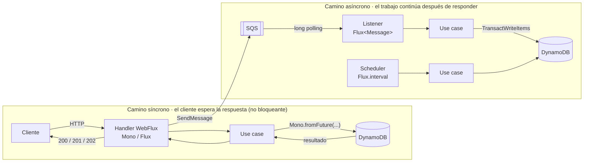

#### 7.0.3 Por qué la arquitectura hexagonal favorece esta mezcla

El **mismo núcleo** (dominio y casos de uso) se invoca desde adaptadores **síncronos** (REST) y **asíncronos** (*listener* SQS, *scheduler*). El caso de uso devuelve `Mono`/`Flux` y no sabe quién lo llama ni si hay un cliente esperando. Por ejemplo, `ReleaseExpiredReservationsUseCase` lo dispara hoy el *scheduler*, pero podría exponerse mañana en un endpoint de administración (síncrono) **sin cambiar una línea del caso de uso**. Que la comunicación sea síncrona o asíncrona es una decisión del **adaptador de entrada**, no del dominio [M15][M21].

### 7.1 Colocar orden y reservar (RF-02, RF-03, RF-05)

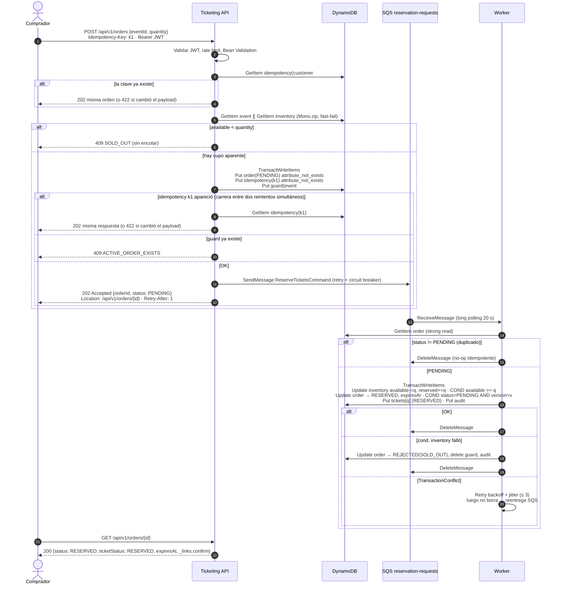

### 7.2 Confirmar y pagar (RF-08)

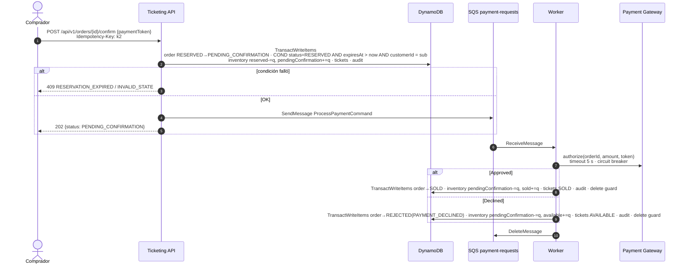

### 7.3 Liberación de reservas vencidas (RF-06)

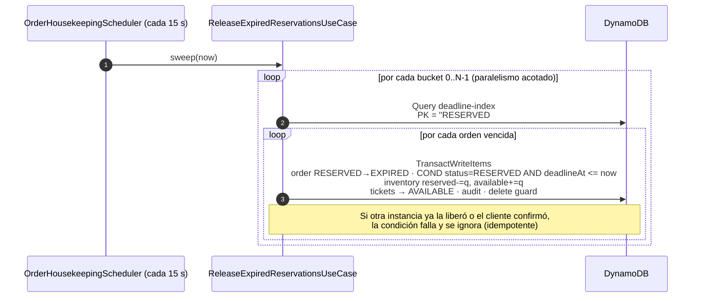

El mismo *scheduler* ejecuta dos barridos más sobre el mismo índice:
- **`PENDING_CONFIRMATION#b` con `deadlineAt <= now`** (*timeout* de pago de 5 min): libera como pago rechazado. Así evita que un pago colgado retenga el inventario para siempre.
- **`PENDING#b` con `deadlineAt <= now`** (30 s sin procesar): vuelve a publicar el comando. Es la red de seguridad del *dual write* entre DynamoDB y SQS (ver ADR-005).

### 7.4 Disponibilidad en tiempo real (RF-07)

- `GET /api/v1/events/{id}/availability` hace un `GetItem` **consistente** del ítem `inventory` y responde con `available`, `held` (`reserved + pendingConfirmation`), `sold`, `complimentary` y `totalCapacity`.
- `GET /api/v1/events/{id}/availability/stream` (`text/event-stream`) usa `Flux.interval(1s)` → lectura → `distinctUntilChanged()` → `onBackpressureLatest()`. Solo emite cuando algo cambia y funciona igual con varias instancias porque lee de la fuente de verdad. Una **micro-caché de 1 s** compartida por evento (patrón *Cache-Aside* con micro-caching [M9]) evita que N suscriptores hagan N lecturas por segundo.
- La evolución para producción (DynamoDB Streams con *fan-out* a WebSocket) está en la sección 22.

---

## 8. Concurrencia y consistencia

Esta es la sección central de la prueba: cómo se evita la sobreventa sin bloqueos.

### 8.1 Mecanismos

| Mecanismo | Dónde | Qué garantiza |
|---|---|---|
| **Escritura condicional sobre contadores** | `inventory`: `SET available = available - :q, reserved = reserved + :q` **con la condición** `available >= :q` | DynamoDB evalúa la condición y la escritura de forma atómica en el ítem. Dos *workers* nunca pueden reservar la misma capacidad. **Es la barrera contra la sobreventa** |
| **`TransactWriteItems`** | Toda transición de orden: inventario + orden + entradas + auditoría + *guard* | Todo o nada en varios ítems (ACID). La auditoría nunca queda desalineada con el estado |
| **Optimistic locking (`version`)** | Ítem `order`: la condición incluye `version = :expected` y la escritura hace `version + 1` | Detecta actualizaciones concurrentes sobre la misma orden, por ejemplo una confirmación del cliente que choca con el barrido del *sweeper* |
| **Guardas de estado** | Condiciones `#status = :expected` en `order` y `ticket` | Hacen idempotente el consumidor *at-least-once*: repetir la transición falla la condición y se trata como `AlreadyProcessed` |
| **Escrituras de creación únicas** | `attribute_not_exists(pk)` en `idempotency-keys`, `order-guards`, `tickets` y `ticket-audit` | Sin duplicados aunque haya carreras en la admisión |
| **Sin locks distribuidos** | — | No hay Redis lock ni `SELECT FOR UPDATE`. La concurrencia es optimista y no bloqueante, coherente con el modelo reactivo |

### 8.2 Interpretación de fallas de transacción

`TransactionCanceledException.cancellationReasons()` devuelve un motivo por cada ítem, en orden. El adaptador lo traduce a un resultado de dominio (*Anti-Corruption Layer*: el dominio nunca ve excepciones del SDK):

| Ítem que falló | Código | Resultado de dominio | Acción |
|---|---|---|---|
| 0 — inventario | `ConditionalCheckFailed` | `Rejected(SOLD_OUT)` | La orden pasa a `REJECTED` y se borra el mensaje |
| 1 — orden | `ConditionalCheckFailed` | `AlreadyProcessed` | Se borra el mensaje (duplicado) |
| cualquiera | `TransactionConflict` | `TransientConflict` | Reintento con *backoff* exponencial y *jitter* (50 ms → 400 ms, 3 intentos). Si persiste, no se borra el mensaje y SQS lo reentrega |
| cualquiera | `ProvisionedThroughputExceeded` o `ThrottlingException` | `TransientConflict` | Igual que la fila anterior |

### 8.3 Por qué no basta con "leer y luego escribir"

Con el patrón ingenuo "leo `available = 1`, valido y escribo `available = 0`", dos *workers* leen 1 al mismo tiempo y ambos venden: es exactamente el defecto actual. Con la escritura condicional, la verificación ocurre **dentro de la escritura**: de dos operaciones concurrentes solo una cumple `available >= 1`. La validación por lectura previa (*fast-fail* en la API) existe solo para ahorrar trabajo y **nunca** sustituye a la condición.

### 8.4 Prueba de concurrencia (RF-05 → QAS-01)

Una prueba lanza 500 reservas concurrentes de 1 entrada contra un evento de capacidad 100 (`Flux.range(0, 500).flatMap(..., 64)` sobre `Schedulers.parallel()`) usando `InMemoryOrderTransitionStore`. Ese *store* reproduce la semántica de escritura condicional con `AtomicReference.compareAndSet`. La prueba verifica:

- exactamente 100 resultados `Reserved` y 400 `Rejected(SOLD_OUT)`;
- el invariante de suma igual a la capacidad;
- ningún contador negativo.

Otra prueba hace lo mismo con mensajes duplicados (cada comando entregado 2 veces) y verifica que el número de efectos sea el mismo.

---

## 9. Persistencia: modelo DynamoDB

### 9.1 Patrones de acceso (primero los accesos, luego las tablas)

| # | Patrón de acceso | Operación | Tabla / índice |
|---|---|---|---|
| A1 | Crear un evento con su inventario | `TransactWriteItems` | `events`, `inventory` |
| A2 | Obtener un evento | `GetItem` | `events` |
| A3 | Listar eventos paginados | `Scan` con `Limit` y `ExclusiveStartKey` (cursor) | `events` |
| A4 | Obtener disponibilidad | `GetItem` consistente | `inventory` |
| A5 | Admitir una orden | `TransactWriteItems` | `orders`, `idempotency-keys`, `order-guards` |
| A6 | Obtener una orden | `GetItem` | `orders` |
| A7 | Transición de orden | `TransactWriteItems` | `inventory`, `orders`, `tickets`, `ticket-audit`, `order-guards` |
| A8 | Órdenes vencidas por estado | `Query` | `orders` / GSI `deadline-index` |
| A9 | Órdenes de un cliente | `Query` | `orders` / GSI `customer-index` |
| A10 | Entradas de una orden | `Query` | `tickets` / GSI `order-index` |
| A11 | Historial de auditoría | `Query` | `ticket-audit` |

### 9.2 Tablas

| Tabla | PK | SK | Atributos principales | Índices y opciones |
|---|---|---|---|---|
| `events` | `eventId` | — | `name`, `venue`, `eventDate`, `totalCapacity`, `createdAt` | — |
| `inventory` | `eventId` | — | `totalCapacity`, `available`, `reserved`, `pendingConfirmation`, `sold`, `complimentary`, `version`, `updatedAt` | — |
| `orders` | `orderId` | — | `eventId`, `customerId`, `quantity`, `status`, `ticketIds`, `expiresAt`, `failureReason`, `version`, `createdAt`, `updatedAt`, **`deadlineKey`**, **`deadlineAt`** | GSI **`deadline-index`** (PK `deadlineKey`, SK `deadlineAt`), **disperso**. GSI `customer-index` (PK `customerId`, SK `createdAt`) |
| `tickets` | `ticketId` | — | `eventId`, `orderId`, `status`, `version`, `updatedAt` | GSI `order-index` (PK `orderId`) |
| `ticket-audit` | `aggregateId` | `sequence` (versión de la orden, con ceros a la izquierda) | `fromStatus`, `toStatus`, `quantity`, `ticketIds`, `actor`, `reason`, `correlationId` | *Append-only* (IAM niega `UpdateItem` y `DeleteItem`) |
| `idempotency-keys` | `scopedKey` (`customerId#key`) | — | `requestHash` (SHA-256), `orderId`, `httpStatus`, `ttl` | TTL de 24 h |
| `order-guards` | `guardKey` (`eventId#customerId`) | — | `orderId`, `createdAt` | Se elimina cuando la orden llega a un estado final |

**`deadline-index` (índice disperso):** solo las órdenes **no finales** tienen `deadlineKey` y `deadlineAt`. Al llegar a un estado final (`SOLD`, `EXPIRED`, `REJECTED`, `CANCELLED`, `COMPLIMENTARY`) la transición hace `REMOVE deadlineKey, deadlineAt` y la orden desaparece del índice. Por eso el *sweeper* solo lee lo que debe procesar, sin `Scan`. `deadlineKey = "<status>#<bucket>"`, donde `bucket = hash(orderId) mod 8`, reparte la partición del GSI para evitar una partición caliente (patrones *Index Table* y *Sharding* [M19]).

**¿Por qué tablas separadas y no *single-table design*?** El *single-table design* optimiza la cantidad de *round-trips*. Aquí las transacciones ya agrupan las escrituras y las lecturas son por clave, así que **la claridad para el equipo y la evaluación pesa más** (modificabilidad [M3]). La migración a una sola tabla queda contenida en `dynamodb-repository`.

### 9.3 Capacidad y costo

- Modo **on-demand** para cargas en picos impredecibles. Antes de una apertura de ventas grande se puede preparar con **warm throughput**.
- Cada transacción de reserva tiene unos 1 + 1 + q + 1 + 1 ítems, que cuestan el doble en WCU (*T4*).
- **PITR** activado y **cifrado SSE-KMS** con una CMK propia en producción.

### 9.4 Acceso reactivo a la persistencia (impacto de WebFlux)

**Principio:** con WebFlux, la cadena debe ser **no bloqueante de extremo a extremo**. WebFlux atiende miles de conexiones con pocos hilos (*event loop* de Netty, más o menos uno por núcleo). Si un adaptador usa un driver bloqueante, ese hilo se detiene y deja de atender a todas las peticiones que tiene asignadas: un solo `getItem()` síncrono bajo carga degrada toda la API [J15].

#### 9.4.1 Qué cambia respecto a una aplicación Spring MVC tradicional

| Aspecto | Spring MVC tradicional (bloqueante) | Este proyecto (WebFlux) |
|---|---|---|
| Cliente de base de datos | JDBC o JPA/Hibernate, o el `DynamoDbClient` síncrono | **`DynamoDbAsyncClient`** del AWS SDK v2 (HTTP no bloqueante sobre Netty) |
| Firma del repositorio | `Optional<Order> findById(...)` | **`Mono<Order> findById(...)`** |
| Consultas paginadas | `List<Order>` | **`Flux<Order>`** desde un `Publisher` de Reactive Streams, con *backpressure* |
| Transacciones | `@Transactional` (vinculado al hilo con `ThreadLocal`) | **`TransactWriteItems`** en una sola llamada. No se usa `@Transactional`: DynamoDB no tiene un `ReactiveTransactionManager` de Spring y el `ThreadLocal` no sirve cuando la ejecución cambia de hilo |
| *Optimistic locking* | `@Version` de JPA | Atributo `version` con `ConditionExpression` explícita (sección 8) |
| Entidades | `@Entity` en el dominio | **Mappers** en el adaptador (`Map<String, AttributeValue>` ↔ objeto de dominio). El dominio no tiene anotaciones de persistencia (Clean Architecture) |
| Spring Data | `JpaRepository` | **No se usa.** Spring Data no tiene módulo oficial reactivo para DynamoDB; el adaptador usa el SDK directamente, lo que además da control fino de condiciones y de `CancellationReasons` |

Si la base fuera relacional, el equivalente reactivo sería **R2DBC** (Spring Data R2DBC) o Hibernate Reactive, nunca JPA o JDBC.

#### 9.4.2 Cómo se convierte una llamada del SDK en un `Mono` o `Flux`

| Operación del SDK | Devuelve | Adaptación a Reactor |
|---|---|---|
| `getItem`, `putItem`, `updateItem`, `transactWriteItems` | `CompletableFuture<…Response>` | `Mono.fromFuture(() -> client.op(request))`, **con `Supplier`** (regla R1 de la sección 6.5) para que cada reintento repita la llamada |
| `queryPaginator`, `scanPaginator` | `QueryPublisher` / `ScanPublisher` (Reactive Streams) | `Flux.from(client.queryPaginator(request).items())`: las páginas se piden según la demanda del suscriptor (*backpressure* real) |
| Lectura de una sola página con cursor (API `GET /events?cursor=`) | `CompletableFuture<ScanResponse>` | `Mono.fromFuture(...)` y luego `LastEvaluatedKey` codificada en Base64 como cursor |

```java
// Single item: lazy Mono over the SDK future
public Mono<Order> findById(OrderId orderId) {
    return Mono.fromFuture(() -> dynamoDb.getItem(r -> r
                    .tableName(tables.orders())
                    .key(Map.of("orderId", AttributeValue.fromS(orderId.value())))
                    .consistentRead(true)))
            .filter(GetItemResponse::hasItem)
            .map(response -> OrderItemMapper.toDomain(response.item()));
}

// Many items: Reactive Streams publisher -> Flux with backpressure (sweeper)
public Flux<Order> findDue(OrderStatus status, int bucket, Instant now, int limit) {
    QueryRequest request = QueryRequest.builder()
            .tableName(tables.orders())
            .indexName("deadline-index")
            .keyConditionExpression("deadlineKey = :key AND deadlineAt <= :now")
            .expressionAttributeValues(Map.of(
                    ":key", AttributeValue.fromS(status.name() + "#" + bucket),
                    ":now", AttributeValue.fromN(String.valueOf(now.getEpochSecond()))))
            .build();
    return Flux.from(dynamoDb.queryPaginator(request).items())
            .take(limit)                                   // cancels upstream: stops requesting pages
            .map(OrderItemMapper::toDomain);
}
```

#### 9.4.3 Modelo de hilos

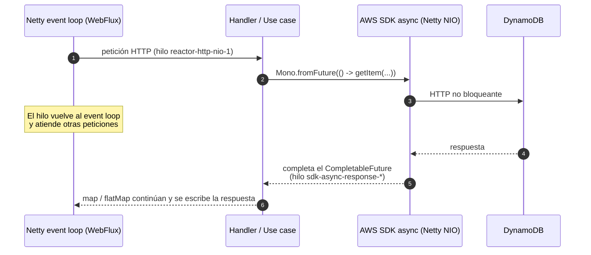

Cuando el `CompletableFuture` del SDK se completa, la cadena de Reactor **continúa en el hilo de respuesta del SDK**. Esto es correcto para el trabajo liviano de este proyecto (mapear y validar). Si existiera procesamiento intensivo de CPU, se movería con `publishOn(Schedulers.parallel())`.

**Vía de escape (no se usa):** si alguna librería solo ofreciera API bloqueante, se aislaría con `Mono.fromCallable(...).subscribeOn(Schedulers.boundedElastic())`. Es un *pool* acotado para bloqueos, nunca el *event loop*. Hoy no hace falta porque DynamoDB y SQS tienen clientes asíncronos.

#### 9.4.4 Configuración del cliente asíncrono (crítica bajo carga)

| Parámetro (`NettyNioAsyncHttpClient` / `ClientOverrideConfiguration`) | Valor | Por qué |
|---|---|---|
| `maxConcurrency` | 200 a 500 por instancia | **El valor por defecto es 50 conexiones.** Bajo un pico, las peticiones hacen fila esperando conexión y aparecen *timeouts* aunque DynamoDB esté sano |
| `connectionAcquisitionTimeout` | 2 s | Falla rápido si el *pool* se agota, en vez de acumular latencia |
| `apiCallAttemptTimeout` / `apiCallTimeout` | 1 s / 3 s | *Timeout* por intento y total (sección 14) |
| `retryStrategy` del SDK | Modo `standard`, máximo 2 intentos | Reintenta *throttling* y errores 5xx. Los conflictos de negocio (`TransactionConflict`) los reintenta Reactor con `RetryPolicies`, **no ambos a la vez**, para no multiplicar los reintentos (3 × 3 = 9) |
| `endpointOverride` | Solo en el perfil `local` (`http://dynamodb-local:8000`) | El mismo código funciona contra DynamoDB Local y AWS (12-factor) |

```java
@Bean
DynamoDbAsyncClient dynamoDbAsyncClient(AwsProperties aws) {
    var builder = DynamoDbAsyncClient.builder()
            .region(Region.of(aws.region()))
            .httpClientBuilder(NettyNioAsyncHttpClient.builder()
                    .maxConcurrency(aws.dynamodb().maxConcurrency())
                    .connectionAcquisitionTimeout(Duration.ofSeconds(2)))
            .overrideConfiguration(c -> c
                    .apiCallAttemptTimeout(Duration.ofSeconds(1))
                    .apiCallTimeout(Duration.ofSeconds(3)));
    aws.dynamodb().endpoint().ifPresent(uri -> builder.endpointOverride(URI.create(uri)));   // local only
    return builder.build();
}
```

Las credenciales nunca se configuran en el código. El SDK usa la cadena por defecto: variables de entorno en local y el *task role* de IAM en ECS (sección 13.2).

#### 9.4.5 Relación con el procesamiento asíncrono por colas

Son dos niveles distintos y complementarios:

1. **Asincronía de E/S (dentro de cada petición o mensaje):** el acceso a DynamoDB es no bloqueante, como se describe en esta sección. Aplica por igual a la API y al *worker*.
2. **Asincronía de negocio (entre procesos):** la orden se persiste en `PENDING` de forma reactiva, se publica en SQS (también con `SqsAsyncClient`, mismo patrón) y otro proceso la completa después.

La persistencia es el **punto de sincronización** entre ambos mundos. Como la escritura en DynamoDB ocurre **antes** de publicar el mensaje, la orden ya es durable cuando el cliente recibe el `202`. Si la publicación falla, el *sweeper* la vuelve a publicar a partir de lo que quedó persistido (ADR-005).

#### 9.4.6 Pruebas de la capa reactiva de persistencia

- **Unitarias:** se simula `DynamoDbAsyncClient` con Mockito devolviendo `CompletableFuture.completedFuture(...)` o `failedFuture(...)` y se verifica con `StepVerifier`, sin Docker ni red.
- **Paginación:** se simula `queryPaginator` con un `QueryPublisher` construido a partir de un `SdkPublisher` de prueba, y se verifica que `take(n)` cancela la solicitud de páginas adicionales.
- **Integración (perfil `it`):** Testcontainers con DynamoDB Local para validar expresiones condicionales y transacciones reales.

---

## 10. Mensajería: SQS

| Parámetro | `reservation-requests` | `payment-requests` | Justificación |
|---|---|---|---|
| Tipo | Standard | Standard | La prueba exige *at-least-once*. Standard tiene throughput casi ilimitado (ADR-005) |
| `VisibilityTimeout` | 60 s | 90 s | Unas 6 veces el p99 de procesamiento. Pago es más alto porque llama a un servicio externo |
| `ReceiveMessageWaitTimeSeconds` | 20 | 20 | *Long polling*: menos recepciones vacías y menos costo |
| `MaxNumberOfMessages` por recepción | 10 | 10 | Lotes |
| `maxReceiveCount` → DLQ | 5 | 5 | Los mensajes venenosos van a DLQ con alarma |
| Retención | 4 días | 4 días | DLQ: 14 días |
| Cifrado | SSE-KMS (prod) / SSE-SQS | igual | En reposo |

**Contrato del mensaje (*Command*):**

```json
{
  "messageId": "0b8e…",
  "type": "ReserveTicketsCommand",
  "orderId": "01J…",
  "eventId": "evt-…",
  "quantity": 2,
  "occurredAt": "2026-10-27T22:00:00Z",
  "schemaVersion": 1
}
```

Los atributos del mensaje llevan `traceparent` (W3C Trace Context) y `correlationId` para tener trazas de punta a punta.

**Ciclo de consumo reactivo (`AbstractSqsListener`, *Template Method*):**

```text
Flux.defer(receive(batch=10, wait=20s)).repeat()           // long polling continuo
  .flatMap(msg -> deserialize(msg)                          // paso fijo
        .flatMap(this::handle)                              // paso variable (subclase)
        .timeout(Duration.ofSeconds(20))
        .then(delete(msg))                                  // ack SOLO tras éxito
        .onErrorResume(e -> logAndLeaveForRedelivery(e)),   // no borra → SQS reentrega → DLQ
     concurrency = 32)                                      // Bulkhead: concurrencia acotada
```

Un rechazo de negocio (por ejemplo `SOLD_OUT`) es un **procesamiento exitoso**: el mensaje se borra. Solo las fallas técnicas dejan el mensaje para reentrega. Al apagar el servicio (*graceful shutdown*), el *worker* deja de recibir y termina lo que está en curso antes de que venza el *visibility timeout*.

---

## 11. Diseño de la API REST

Diseño según las reglas de **M10** (Massé y Fielding): URIs en minúscula con guiones, sustantivos en plural para colecciones, verbos solo en recursos controladores, sin extensiones y versión en la ruta.

| Método | URI | Arquetipo [M10] | Rol | Respuesta | Requisito |
|---|---|---|---|---|---|
| `POST` | `/api/v1/events` | Colección | ADMIN | `201` + `Location` | RF-01 |
| `GET` | `/api/v1/events?limit=20&cursor=…` | Colección | USER | `200` `Flux` paginado | RF-01 |
| `GET` | `/api/v1/events/{eventId}` | Documento | USER | `200` / `404` | RF-01 |
| `GET` | `/api/v1/events/{eventId}/availability` | Documento | público | `200` | RF-07 |
| `GET` | `/api/v1/events/{eventId}/availability/stream` | Documento (SSE) | público | `text/event-stream` | RF-07 |
| `POST` | `/api/v1/orders` | Colección | USER | **`202`** + `Location` + `Retry-After` | RF-02, RF-03 |
| `GET` | `/api/v1/orders/{orderId}` | Documento | USER (dueño) | `200` con `_links` (HATEOAS) | RF-04 |
| `POST` | `/api/v1/orders/{orderId}/confirm` | **Controlador** (verbo) | USER (dueño) | `202` | RF-08 |
| `POST` | `/api/v1/orders/{orderId}/cancel` | **Controlador** (verbo) | USER (dueño) | `200` | RF-10 |
| `POST` | `/api/v1/events/{eventId}/complimentary-tickets` | Colección | ADMIN | `201` | RF-09 |

**Ejemplo de respuesta `GET /api/v1/orders/{id}`:**

```json
{
  "orderId": "01JB7Q…",
  "eventId": "evt-rock-2026",
  "quantity": 2,
  "status": "RESERVED",
  "ticketStatus": "RESERVED",
  "ticketIds": ["tkt-…", "tkt-…"],
  "expiresAt": "2026-10-27T22:10:00Z",
  "_links": {
    "self":    { "href": "/api/v1/orders/01JB7Q…" },
    "confirm": { "href": "/api/v1/orders/01JB7Q…/confirm", "method": "POST" },
    "cancel":  { "href": "/api/v1/orders/01JB7Q…/cancel",  "method": "POST" },
    "event":   { "href": "/api/v1/events/evt-rock-2026" }
  }
}
```

**Errores:** todos siguen **RFC 9457 Problem Details** (`application/problem+json`) con `type`, `title`, `status`, `detail`, `instance`, `code` y `correlationId`. Nunca se exponen trazas de pila.

| HTTP | `code` | Cuándo |
|---|---|---|
| 400 | `VALIDATION_ERROR` | El *payload* no cumple el contrato |
| 401 / 403 | `UNAUTHORIZED` / `FORBIDDEN` | Sin token, o sin el rol o la propiedad del recurso |
| 404 | `EVENT_NOT_FOUND` / `ORDER_NOT_FOUND` | El recurso no existe, o pertenece a otro cliente (no se revela que existe) |
| 409 | `SOLD_OUT` / `ACTIVE_ORDER_EXISTS` / `INVALID_STATE_TRANSITION` / `RESERVATION_EXPIRED` | Conflictos de negocio |
| 422 | `IDEMPOTENCY_KEY_REUSED` | La misma clave llegó con otro *payload* |
| 428 | `IDEMPOTENCY_KEY_REQUIRED` | Falta la cabecera en un `POST` que la exige |
| 429 | `RATE_LIMITED` | Se superó la tasa permitida (incluye `Retry-After`) |
| 503 | `SERVICE_UNAVAILABLE` | Circuito abierto hacia SQS o DynamoDB (incluye `Retry-After`) |

El contrato de la API se documenta en el README y en la colección Postman. Publicar una especificación **OpenAPI 3.1** generada desde el código queda como mejora (sección 22).

---

## 12. Catálogo de patrones aplicados

### 12.1 Estilos arquitectónicos [M7][M11][M13][M15]

| Estilo o patrón | Aplicación | Fuente |
|---|---|---|
| **Event-Driven Architecture, topología mediador** | El agregado `Order` orquesta los pasos (reservar → confirmar → pagar → vender o liberar). Los *workers* son procesadores de eventos atómicos e independientes | [M11] |
| **Broker** | SQS como intermediario que desacopla productor y consumidor | [M7] |
| **Clean Architecture / Hexagonal** | Puertos (gateways) y adaptadores (*driven adapters* y *entry points*) | [M15][M21] |
| **Capas** | Dominio → casos de uso → infraestructura, con dependencias hacia adentro | [M7] |
| **Cliente-servidor y REST** | API con restricciones de Fielding: *stateless*, interfaz uniforme, HATEOAS y *cacheable* | [M10] |
| **CQRS ligero** | Los comandos van por cola hacia el *worker*. Las consultas leen directo la vista materializada (`inventory`). No hay *stores* separados | [M13][M19] |
| **Saga / transacción compensatoria** | Liberar el inventario al vencer la reserva o al rechazarse el pago compensa la reserva previa | [M13][M19] |

### 12.2 Patrones de diseño GoF [M5]

| Patrón | Tipo | Dónde | Problema que resuelve |
|---|---|---|---|
| **State** | Comportamiento | `TicketStatus` y `OrderStatus` con sus transiciones permitidas | Elimina condicionales repetidos sobre el estado; las transiciones inválidas son imposibles |
| **Command** | Comportamiento | `ReserveTicketsCommand` y `ProcessPaymentCommand` (records serializados en SQS) | Encapsula una solicitud para ejecutarla de forma diferida en otro proceso |
| **Template Method** | Comportamiento | `AbstractSqsListener`: recibir → deserializar → `handle()` → confirmar | El ciclo de consumo se escribe una sola vez y cada cola implementa solo `handle()` |
| **Strategy** | Comportamiento | `PaymentGateway` (simulado o real) y la política de reintento | Algoritmos intercambiables sin cambiar a quien los usa |
| **Observer / Pub-Sub** | Comportamiento | SSE de disponibilidad; eventos de dominio hacia la auditoría | Notificar a muchos suscriptores sin acoplarlos |
| **Chain of Responsibility** | Comportamiento | Cadena de `WebFilter`: correlación → *rate limit* → seguridad → manejador | Preocupaciones transversales independientes y ordenadas |
| **Factory Method** | Creacional | `Order.place(...)`, `Ticket.reserve(...)` y fábricas de *mappers* | Creación válida por construcción, sin estados intermedios inválidos |
| **Builder** | Creacional | Construcción de `TransactWriteItemsRequest` (SDK) y de los `OrderTransition` en pruebas | Objetos complejos legibles |
| **Adapter** | Estructural | Todos los `driven-adapters` (DynamoDB, SQS, pagos) | Traducen la API del proveedor al puerto del dominio |
| **Facade** | Estructural | `DynamoDbOrderTransitionStore` oculta transacciones, expresiones y la lectura de los motivos de cancelación | Una interfaz simple (`commit(transition)`) sobre un subsistema complejo |
| **Decorator** | Estructural | Reintento, *circuit breaker* y métricas que envuelven al *publisher* | Agregar responsabilidades sin modificar la clase |
| **Proxy** | Estructural | API Gateway y ALB como *reverse proxy* | Punto único de entrada, TLS y balanceo |

### 12.3 Patrones cloud y de mensajería [M19][M9][M13]

| Patrón | Categoría | Aplicación |
|---|---|---|
| **Queue-Based Load Leveling** | Mensajería | SQS absorbe el pico y los *workers* procesan a su ritmo |
| **Competing Consumers** | Mensajería | N tareas *worker* consumen la misma cola |
| **Asynchronous Request-Reply** | Mensajería | `202` + `Location` + `Retry-After` y luego *polling* o SSE |
| **Priority Queue** (por aislamiento) | Mensajería | Una cola para pagos separada de reservas: quien ya está pagando no espera detrás del pico de reservas |
| **Retry** (*backoff* exponencial con *jitter*) | Resiliencia | Conflictos transitorios de DynamoDB y envíos a SQS |
| **Circuit Breaker** | Resiliencia | Llamadas a SQS (API) y al *gateway* de pagos (*worker*) |
| **Bulkhead** | Resiliencia | Concurrencia acotada por *listener*, *pools* separados y servicios ECS separados para `api` y `worker` |
| **Throttling / Rate Limiting** | Resiliencia y seguridad | WAF, API Gateway y un filtro por cliente en la aplicación |
| **Saga** (compensación) | Datos | Liberar la reserva o el pago rechazado |
| **Index Table** | Datos | GSI disperso `deadline-index` |
| **Materialized View** | Datos | `inventory` es la vista materializada de los estados de las entradas |
| **Sharding** | Datos | Buckets en `deadlineKey`. *Sharding* de inventario documentado como evolución |
| **Cache-Aside / micro-caching** | Datos [M9] | Disponibilidad con TTL de 1 s; catálogo con caché HTTP (`Cache-Control`) y CDN |
| **Gateway Offloading / Routing** | Diseño | TLS, validación de JWT, *throttling* y WAF en el borde |
| **Anti-Corruption Layer** | Diseño | `SimulatedPaymentGateway` y la traducción de errores del SDK a resultados de dominio |
| **Sidecar** | Diseño | Colector ADOT (OpenTelemetry) junto a cada tarea ECS |
| **External Configuration Store** | Diseño | SSM Parameter Store y Secrets Manager (12-factor) |
| **Idempotent Consumer** y **Idempotency Key** | Mensajería | Guardas de estado en el consumidor y cabecera en la API |
| **Transactional Outbox (ligero)** | Mensajería | El estado `PENDING` con `deadlineAt` funciona como *outbox* consultable y el *sweeper* vuelve a publicar |

### 12.4 Twelve-Factor App [M19]

Base de código única con dos procesos (`api` y `worker`), dependencias declaradas (Maven), configuración en variables de entorno, servicios externos como recursos adjuntos (los *endpoints* de DynamoDB y SQS son configurables), *build/release/run* separados (imagen inmutable), procesos *stateless*, puerto expuesto (8080), concurrencia por tipo de proceso, *disposability* (arranque rápido y apagado ordenado), paridad entre desarrollo y producción (Compose emula los mismos servicios), logs a `stdout` en JSON y procesos de administración como tareas puntuales (script de inicialización).

---

## 13. Seguridad

### 13.1 Mapeo contra OWASP Top 10:2025 [D5]

| Riesgo OWASP 2025 | Control aplicado |
|---|---|
| **A01 Broken Access Control** | `customerId` se toma **del `sub` del JWT**, nunca del cuerpo de la petición. Se verifica la propiedad en `GET`, `confirm` y `cancel` (si no es el dueño responde `404`). Las rutas de administración exigen el *scope* `ticketing:admin` |
| **A02 Security Misconfiguration** | Actuator expone solo `health` e `info` en un puerto de gestión separado. CORS restrictivo. Cabeceras de seguridad. Los perfiles `local` y `prod` están separados |
| **A03 Software Supply Chain Failures** | Dependabot y OWASP Dependency-Check, SBOM (CycloneDX), escaneo de la imagen con Trivy y versiones fijadas de las imágenes base |
| **A04 Cryptographic Failures** | TLS 1.2 o superior en el borde, KMS para DynamoDB y SQS. No se guardan datos de tarjeta: el pago usa un *token* del *gateway* (fuera del alcance de PCI) |
| **A05 Injection** | DynamoDB con `ExpressionAttributeValues` (sin concatenar cadenas), Bean Validation en todos los DTOs y lista blanca de formatos de ID |
| **A06 Insecure Design** | Idempotencia, límites por orden y por cliente, *guard* de orden activa y reserva con vencimiento (defensa contra acaparamiento) |
| **A07 Authentication Failures** | OAuth2 / OIDC con Cognito. JWT validado por firma (JWKS), `iss`, `aud` y `exp`. No se implementa autenticación propia |
| **A08 Software or Data Integrity Failures** | Auditoría *append-only* con IAM que niega `Update` y `Delete`. Imágenes firmadas (cosign). El *pipeline* asume un rol AWS por OIDC, sin llaves de larga duración |
| **A09 Security Logging & Alerting Failures** | Logs estructurados con `correlationId` y sin datos personales. Alarmas por `401`, `403` y `429` anómalos y por mensajes en la DLQ |
| **A10 Mishandling of Exceptional Conditions** | Manejador de errores global con Problem Details, sin trazas de pila. Las condiciones de error del SDK se traducen de forma explícita (sección 8.2) |

### 13.2 Secretos y credenciales

| Entorno | Estrategia |
|---|---|
| Local | Las credenciales de LocalStack y DynamoDB Local son ficticias (`test` / `test`) e intencionalmente no secretas. Se definen en `.env` (en `.gitignore`), y se versiona un `.env.example` |
| AWS | **Cero secretos estáticos.** Las tareas ECS usan un *task role* de IAM con mínimo privilegio para DynamoDB y SQS, con credenciales temporales vía STS. La configuración no sensible va en SSM Parameter Store; la sensible, como la llave del *gateway* de pagos, en **Secrets Manager** con rotación, inyectada como `secrets` en la *task definition* |
| CI/CD | GitHub Actions asume un rol de AWS por **OIDC**. *gitleaks* en cada *push* bloquea secretos versionados |

### 13.3 Ataques y abuso considerados

| Ataque | Mitigación |
|---|---|
| **Reintentos maliciosos o *replay*** | `Idempotency-Key` obligatoria en `POST /orders`, con un ámbito por cliente. `POST /confirm` y `POST /cancel` son idempotentes por la máquina de estados: repetirlos devuelve el estado actual (y `confirm` vuelve a publicar el pago, que el *gateway* deduplica por `orderId`). Se guarda un hash del *payload*: si la clave se reutiliza con otro contenido, responde `422`. TTL de 24 h |
| **Acaparamiento de inventario (*scalping*)** | Máximo 10 entradas por orden (`Quantity`), una orden activa por cliente y evento (`order-guards`, atómico) y reservas que vencen a los 10 min |
| **Inundación de la cola** | *Fast-fail* `409 SOLD_OUT` antes de encolar, *rate limit* por cliente (*token bucket*) y reglas por tasa del WAF por IP |
| **Abuso de recursos SSE** | Límite de conexiones SSE por IP, *timeout* de inactividad y micro-caché compartida |
| **Enumeración de órdenes** | Los IDs son aleatorios (UUID / ULID) y una orden ajena devuelve `404` |
| **Mensajes venenosos** | Validación del esquema (`schemaVersion`) y DLQ después de 5 intentos, con alarma |

---

## 14. Resiliencia y tolerancia a fallos

| Falla | Comportamiento esperado |
|---|---|
| Un *worker* muere a mitad de un mensaje | El mensaje no se borró, reaparece tras el *visibility timeout* y el consumidor idempotente evita el doble efecto (QAS-05) |
| SQS no está disponible al admitir una orden | Reintento de 3 intentos y luego *circuit breaker* abierto. La orden ya quedó en `PENDING` y el *sweeper* la vuelve a publicar en 30 s. El cliente recibe `202` de todas formas, porque la orden es durable |
| DynamoDB devuelve *throttling* | Reintento con *backoff*. Si persiste, la API responde `503` con `Retry-After` y el *worker* no borra el mensaje |
| El *gateway* de pagos está caído | *Circuit breaker* abierto: el mensaje se reentrega y el *timeout* de pago (5 min) libera el inventario si no se recupera |
| Una AZ cae | Hay tareas ECS en 3 AZ. DynamoDB y SQS son regionales y *multi-AZ* por diseño |
| Error en un despliegue | ECS con *deployment circuit breaker* y *rollback* automático. Las *health checks* de *readiness* evitan recibir tráfico antes de estar listo |

**Tiempos de espera en toda llamada remota.** Toda llamada a un sistema remoto tiene `timeout()` explícito en Reactor. Sin *timeouts* no hay resiliencia.

---

## 15. Observabilidad y métricas

### 15.1 Telemetría

| Señal | Implementación |
|---|---|
| **Logs** | JSON estructurado a `stdout` (Logback y el formato estructurado de Spring Boot) con `correlationId`, `orderId`, `eventId` y `traceId`. Sin datos personales |
| **Métricas** | Micrometer, exportadas a CloudWatch (EMF) o Prometheus |
| **Trazas** | Micrometer Tracing con OpenTelemetry y el colector ADOT (*sidecar*) hacia X-Ray. El `traceparent` viaja en los atributos del mensaje SQS, así que la traza va de la API al *worker* y a DynamoDB sin cortes |
| **Salud** | `liveness` y `readiness` de Actuator, usadas por ECS y el ALB |

### 15.2 Métricas de negocio y técnicas [M18][D1][D2]

| Métrica | Tipo | Alarma |
|---|---|---|
| `ticketing.orders.placed` | Contador | — |
| `ticketing.reservations{outcome=reserved\|sold_out\|duplicate}` | Contador | Tasa de `duplicate` anómala |
| `ticketing.oversell.prevented` (fallas de condición en el inventario) | Contador | Informativa: muestra la contención |
| `ticketing.inventory.invariant.violations` | Contador | **> 0 → página inmediata (SEV1)** |
| `ticketing.reservations.expired` | Contador | — |
| `ticketing.order.processing.latency` (desde `PENDING` hasta un estado terminal o `RESERVED`) | Temporizador p50/p95/p99 | p99 > 5 s |
| `http.server.requests` (latencia, 5xx) | Temporizador | p95 > 200 ms en `POST /orders`; 5xx > 1 % |
| SQS `ApproximateAgeOfOldestMessage` | CloudWatch | > 60 s |
| SQS DLQ `ApproximateNumberOfMessagesVisible` | CloudWatch | **> 0** |
| DynamoDB `ThrottledRequests` y `TransactionConflict` | CloudWatch | > umbral |

### 15.3 Métricas de entrega (DORA) [D1][D5][M18]

Se miden desde el *pipeline*: **frecuencia de despliegue**, **lead time** de cambios, **tasa de fallos por cambio** y **tiempo de recuperación tras un despliegue fallido** (MTTR). La meta es el nivel **Elite** de la tabla DORA [D5]: lead time menor a un día, despliegues bajo demanda, fallos por cambio ≤ 5 % y recuperación en menos de una hora. Se complementan con la **tasa de escape de defectos**, el **MTTD** y el **cumplimiento del SLO** [M18].

**SLO propuestos:** disponibilidad de la API del 99,9 % mensual; el 99 % de las órdenes llega a un estado de reserva (`RESERVED` o `REJECTED`) en ≤ 5 s.

---

### 15.4 Rendimiento y presupuesto de latencia

Se distinguen cuatro tiempos, que se miden por separado porque optimizar uno puede empeorar otro:

| Tiempo | Qué es | Meta de diseño |
|---|---|---|
| Respuesta de la API | Lo que espera el cliente por el `202` o el `200` | `POST /orders` p95 < 200 ms |
| Tiempo al resultado | De `PENDING` a `RESERVED` o `REJECTED` | p99 < 5 s |
| Drenado del pico | Vaciado de la cola en una apertura de ventas | Mensaje más antiguo < 60 s |
| Arranque y escalado | Desde que se lanza una tarea hasta que recibe tráfico | < 30 s |

**Presupuesto de `POST /orders`** (estimaciones típicas dentro de una región de AWS, a validar con pruebas de carga):

| Paso | Estimado | Técnica |
|---|---|---|
| WAF + API Gateway + VPC Link | 10–20 ms | Costo fijo de la seguridad en el borde |
| Validar JWT | < 1 ms | JWKS en caché; no se consulta a Cognito por petición |
| Lookup de idempotencia | 3–5 ms | `GetItem` por clave |
| Evento + inventario | 5–10 ms | **En paralelo con `Mono.zip`** |
| `TransactWriteItems` (orden + idempotencia + *guard*) | 15–25 ms | Una sola llamada para tres escrituras |
| `SendMessage` a SQS | 10–20 ms | Conexiones reutilizadas y VPC Endpoint |
| **Total** | **≈ 45–80 ms** | Holgura frente a la meta |

**Técnicas por capa:**

| Capa | Técnica |
|---|---|
| Camino crítico | Encolar la reserva, el pago y la liberación; *fast-fail* `409` antes de escribir |
| Viajes de red | Transacciones multi-ítem, `ReturnValuesOnConditionCheckFailure = ALL_OLD`, recepción de 10 mensajes por llamada |
| Consistencia | Lectura fuerte solo en inventario y orden; eventual en catálogo (mitad de costo) |
| Caché [M9] | Micro-caché de 1 s de disponibilidad (SSE); `Cache-Control` y CDN para el catálogo. **Nunca** caché para decidir una venta |
| Conexiones | *Pool* del SDK de 200 a 500 conexiones (por defecto 50); VPC Endpoint *gateway* para DynamoDB |
| *Worker* | `flatMap(…, 32)`, *long polling*, escalado por *backlog* y **escalado programado** antes de aperturas conocidas |
| JVM (Java 25) | Caché AOT (JEP 483, 514, 515) para arrancar y calentar antes; *Compact Object Headers* (JEP 519); G1 por defecto y ZGC si el p99 muestra pausas; *native image* como opción |
| Cliente | `Retry-After: 1` y SSE en lugar de *polling* agresivo |

**Medición:** histogramas de Micrometer (p50/p95/p99), trazas distribuidas por paso, k6 o Gatling para simular la apertura, **JMH** [J16] para el código de CPU (mappers, serialización) y JFR o async-profiler para encontrar cuellos de botella.

## 16. Despliegue en AWS e infraestructura como código

### 16.1 Vista física (modelo 4+1) [M15]

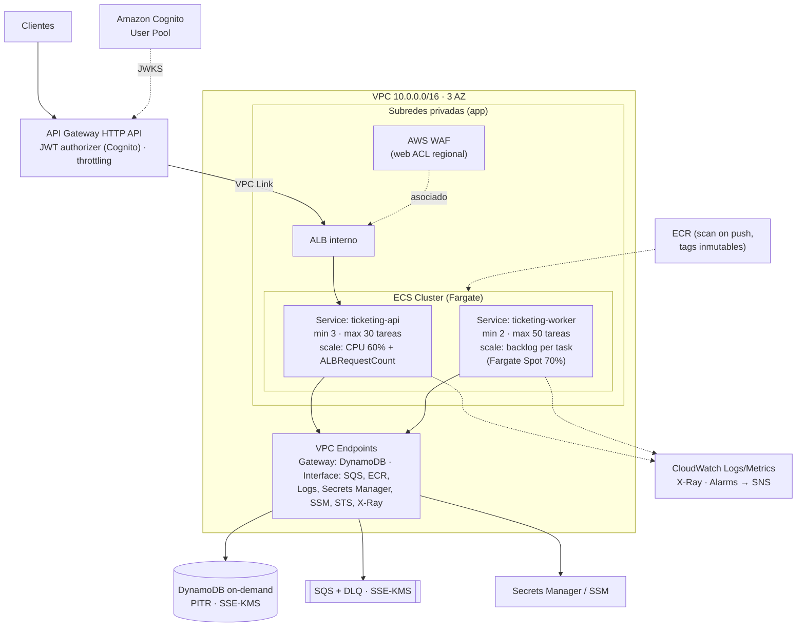

**Decisiones de red y seguridad:**
- **WAF sobre el ALB.** Las HTTP APIs de API Gateway no admiten asociación directa con AWS WAF, así que el *web ACL* (reglas administradas de AWS y límite por IP) protege el ALB interno al que llega el VPC Link. La alternativa equivalente es una REST API o CloudFront delante.
- **SSE detrás de API Gateway.** La integración se corta a los 29 s; `EventSource` se reconecta solo. Para *streams* largos en producción se expone por CloudFront o un ALB público con WAF.
- **Scopes de Cognito.** Cognito los emite como `ticketing/purchase`; la API los normaliza a `ticketing:purchase` en su convertidor JWT.
- **No hay NAT Gateway.** Todo el tráfico hacia servicios AWS va por VPC Endpoints. Esto reduce costo (el NAT es de los componentes más caros en cargas pequeñas) y superficie de ataque. Solo se agrega NAT si el *gateway* de pagos real es externo a AWS.
- **Security groups encadenados:** el ALB solo acepta tráfico desde el VPC Link y las tareas solo desde el SG del ALB. El *worker* no tiene ningún puerto de entrada.
- **IAM de mínimo privilegio por servicio:** `api` puede hacer `dynamodb:GetItem`, `Query` y `TransactWriteItems` sobre sus tablas y `sqs:SendMessage`. `worker` puede `Receive`, `Delete` y `ChangeMessageVisibility` sobre sus colas, más las operaciones de DynamoDB necesarias. Nadie tiene `dynamodb:DeleteItem` ni `UpdateItem` sobre `ticket-audit`.
- **Endpoint policies** restringen los VPC Endpoints a las tablas y colas propias.

### 16.2 ¿Por qué ECS Fargate? [M8][M12]

| Opción | Ventajas | Desventajas | Veredicto |
|---|---|---|---|
| **ECS Fargate** | Sin servidores que administrar, adecuado para procesos de larga vida (WebFlux, SSE, *long polling*), escalado por *backlog* y costo predecible | Escalado de segundos, no de milisegundos | ✅ **Elegido** |
| Lambda (FaaS) | Escala a cero y se integra nativamente con SQS (*event source mapping*) | Arranque en frío de la JVM, no sirve para SSE de larga duración y el modelo reactivo pierde sentido | Alternativa para el *worker* (ver la sección 22) |
| EKS | Muy flexible | Costo operativo alto para un solo servicio | ❌ Sobredimensionado |

### 16.3 Estructura Terraform

```text
infra/terraform/
├── modules/
│   ├── network/        # VPC, subredes privadas/públicas, VPC endpoints, SGs
│   ├── data/           # Tablas DynamoDB + GSIs + TTL + PITR + KMS
│   ├── messaging/      # Colas SQS + DLQs + redrive policy + KMS + alarmas
│   ├── identity/       # Cognito user pool, resource server, scopes
│   ├── compute/        # ECR, ECS cluster, task definitions, services, autoscaling, IAM roles
│   ├── edge/           # API Gateway HTTP API, VPC Link, ALB, WAF
│   └── observability/  # Log groups (retención), dashboards, alarmas, SNS
└── envs/
    ├── dev/            # backend.tf (state S3 propio), main.tf, terraform.tfvars
    ├── staging/
    └── prod/
```

**Decisiones de IaC:**
- **Aislamiento de entornos:** un directorio, un archivo de estado y, en producción, **una cuenta AWS por entorno** (AWS Organizations). No se usan *workspaces* para aislar producción, porque comparten el mismo *backend* y aumentan el riesgo de error humano.
- **Estado remoto** en S3 con cifrado, versionado y **bloqueo nativo de S3** (`use_lockfile = true`, Terraform ≥ 1.10).
- **Módulos versionados y reutilizables.** Los entornos solo cambian variables: tamaños, `min` y `max` de tareas, retención de logs y *deletion protection*.
- **Calidad del código IaC en CI:** `terraform fmt -check`, `validate`, `tflint` y **Checkov** (políticas de seguridad). El `plan` se publica como comentario en el *pull request* y el `apply` requiere aprobación manual en producción.
- **Gobernanza:** `default_tags` obligatorios (`Project`, `Environment`, `Owner` y `CostCenter`), AWS Budgets con alertas, AWS Config para *drift* y cumplimiento, y SCPs de la organización.

### 16.4 Costos

| Palanca | Decisión |
|---|---|
| DynamoDB | *On-demand* para picos. Si la carga base se vuelve estable, migrar a aprovisionado con *auto scaling* y capacidad reservada |
| Cómputo | El *worker* usa Fargate Spot (70 %), lo que es seguro porque el consumidor es idempotente y SQS reentrega. La API usa Fargate *on-demand*. Imagen ARM64 (Graviton), unas 20 % más barata |
| Red | VPC Endpoints en lugar de NAT Gateway |
| Logs | Retención de 30 días en desarrollo y 90 en producción, con nivel `INFO` |
| SQS | *Long polling* para menos recepciones vacías |

---

## 17. Entorno local con Docker

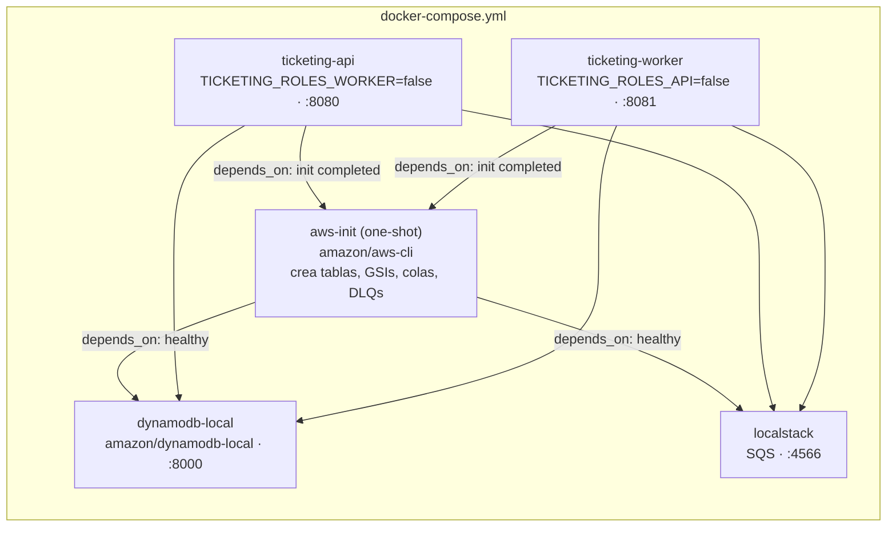

- **Una sola imagen, dos servicios:** un `Dockerfile` *multi-stage* (compilación con Maven y JDK 25, *runtime* con JRE 25), usuario **no root**, `HEALTHCHECK` y opciones de JVM para contenedores (`-XX:MaxRAMPercentage=75`).
- **Dependencias ordenadas:** `depends_on` con `condition: service_healthy` y `service_completed_successfully`.
- **Respaldo para la cola:** si la versión de LocalStack requiere token de cuenta, un perfil de Compose permite usar **ElasticMQ**, compatible con la API de SQS. La prueba lo permite ("o cualquier otra solución que cumpla esta función").

---

## 18. CI/CD y DevSecOps

Se reemplaza el modelo en silos por una cadena DevOps automatizada [M17][D1].

```mermaid
flowchart LR
    A["Push / PR"] --> B["Build + Unit tests<br/>JaCoCo gate ≥ 90%"]
    B --> C["SAST (CodeQL/Semgrep)<br/>SCA (Dependency-Check)<br/>gitleaks"]
    C --> D["ArchUnit<br/>(regla de dependencias)"]
    D --> E["Docker build<br/>SBOM (CycloneDX)<br/>Trivy scan · cosign"]
    E --> F["Terraform fmt/validate<br/>tflint · Checkov · plan"]
    F --> G["Deploy dev<br/>(OIDC → ECR/ECS)"]
    G --> H["Smoke + contract tests<br/>(colección Postman / Newman)"]
    H --> I{"Aprobación<br/>manual"}
    I --> J["Deploy prod<br/>rolling + circuit breaker<br/>(o blue/green)"]
    J --> K["Métricas DORA<br/>+ alarmas"]
```

Este flujo corresponde al nivel 2 a 3 de **OWASP DSOMM** [D5] en las dimensiones de *build*, *deployment*, *test & verification* e *information gathering*. Por la Ley de Conway [M4][D6], un equipo *stream-aligned* (Team Topologies [D5]) es dueño del servicio de punta a punta: *you build it, you run it* [M12][M13].

---

## 19. Estrategia de pruebas

| Nivel | Qué se prueba | Herramientas | Ejemplos |
|---|---|---|---|
| **Dominio** | Invariantes, transiciones válidas e inválidas y value objects | JUnit 5, AssertJ, pruebas parametrizadas | Todas las combinaciones `TicketStatus × TicketStatus`; `Quantity` fuera de 1–10; invariante de `Inventory` |
| **Casos de uso** | La orquestación con los puertos simulados | Mockito y **reactor-test (`StepVerifier`)** | `PlaceOrderUseCase` con clave repetida devuelve la misma orden; `ReserveTicketsUseCase` con `AlreadyProcessed` no tiene efecto; *sweeper* con lista vacía |
| **Concurrencia** | Que no haya sobreventa ni efectos dobles | `Flux.flatMap` en paralelo sobre `InMemoryOrderTransitionStore` | 500 reservas para 100 cupos dan exactamente 100; mensajes duplicados; carrera entre confirmar y vencer |
| **Entry points web** | Rutas, validación, códigos HTTP, Problem Details y seguridad | `@WebFluxTest` y **`WebTestClient`**, `spring-security-test` (`mockJwt()`) | `POST /orders` sin `Idempotency-Key` da `428`; sin token `401`; orden ajena `404`; SSE con `StepVerifier` |
| **Entry points SQS** | Confirmar solo tras éxito, no borrar ante error y deserialización | Mockito sobre `SqsAsyncClient` y `StepVerifier.withVirtualTime` | Un error técnico no llama a `deleteMessage` |
| **Driven adapters** | El mapeo a `TransactWriteItemsRequest` y la lectura de `CancellationReasons` | Mockito sobre `DynamoDbAsyncClient` con `ArgumentCaptor` | El ítem 0 falla → `Rejected(SOLD_OUT)`; `TransactionConflict` → reintento |
| **Arquitectura** | La regla de dependencias | **ArchUnit** | `domain..` no depende de `org.springframework..` ni de `software.amazon..` |
| **Integración** (perfil `it`, opcional) | Flujo real contra DynamoDB Local y LocalStack | Testcontainers | De la orden a `RESERVED`, luego a `SOLD`, y el vencimiento |
| **Carga** (fuera del CI) | QAS-01, QAS-03 y QAS-06 | k6 o Gatling | Rampa hasta 2.000 req/s |

**Quality gate:** JaCoCo con la regla `LINE ≥ 0.90` por módulo, que **falla el build** si no se cumple. Se aplica a los 10 módulos con lógica; `app-service` (clase `main` y clases `@Configuration` de *wiring*) reporta su cobertura sin bloquear el build y se valida con la prueba de contexto de Spring Boot y ArchUnit. La excepción está declarada en su `pom.xml` y justificada en el README.

---

## 20. Validación de la arquitectura (ATAM)

Se aplica una versión ligera de **ATAM** [M4]: los escenarios priorizados (sección 3) se cruzan con las decisiones para identificar puntos de sensibilidad, puntos de *trade-off*, riesgos y no-riesgos.

| Tipo | Elemento | Escenarios afectados |
|---|---|---|
| **Punto de sensibilidad** | Ítem único de `inventory` por evento: su límite de escritura determina el *throughput* máximo de reservas por evento | QAS-01, QAS-03, QAS-06 |
| **Punto de sensibilidad** | `VisibilityTimeout` frente al tiempo de procesamiento: si es demasiado corto produce duplicados; si es demasiado largo, la recuperación es lenta | QAS-05 |
| **Punto de trade-off** | Encolar antes de validar (`202`): mejora la latencia y la disponibilidad de la admisión (QAS-03) a costa de la inmediatez del resultado | QAS-03 vs. experiencia de usuario |
| **Punto de trade-off** | Transacciones con auditoría incluida: más integridad y no repudio (QAS-02) a cambio de más WCU y latencia | QAS-02 vs. QAS-03 y costo |
| **Riesgo R1** | Contención en eventos muy populares: más de 1.000 escrituras por segundo sobre un mismo ítem de inventario | Mitigación: *sharding* de inventario y sala de espera virtual (sección 22) |
| **Riesgo R2** | *Dual write* entre DynamoDB y SQS en la admisión | Mitigación: re-publicación por el *sweeper* (*outbox* ligero). En producción, *outbox* por DynamoDB Streams (sección 22) |
| **Riesgo R3** | *Sweeper* dentro de la aplicación: todas las instancias barren | Mitigación: es idempotente por escrituras condicionales. Mejora: *lease* por bucket o EventBridge Scheduler |
| **No-riesgo** | Duplicados de SQS Standard | Neutralizados por las guardas de estado y la versión |
| **No-riesgo** | Caída de una AZ | Servicios *multi-AZ* y tareas repartidas |

**Validación continua [M4]:** además de esta validación inicial, la revisión de arquitectura forma parte de la **Definition of Done** de cada historia [M21], ArchUnit valida en el *pipeline* y se mantiene un registro de ADR vivo.

---

## 21. Registro de Decisiones de Arquitectura (ADR)

Formato Nygard: contexto, decisión, alternativas, consecuencias y trazabilidad. Todas tienen estado **Aceptada**.

### ADR-001 — Estilo: EDA con topología mediador, Clean Architecture y despliegue modular en dos roles

- **Contexto:** hay picos de miles de compras por segundo y procesamiento pesado (validar, reservar, pagar). La restricción es no proponer un monolito acoplado si el dominio exige escalar partes por separado. Hay un solo *bounded context* y un equipo pequeño.
- **Decisión:** arquitectura orientada a eventos con **topología mediador** (el agregado `Order` orquesta), Clean Architecture y hexagonal por dentro, y **una imagen desplegada en dos roles** (`api` y `worker`) como servicios ECS separados que escalan por señales distintas. No se usan Virtual Threads en la ruta de petición: WebFlux ya es no bloqueante.
- **Alternativas:**
    1. Monolito síncrono con Spring MVC y Virtual Threads. Es simple, pero no amortigua picos y deja el escalado acoplado.
    2. Microservicios por subdominio (Catalog, Inventory, Ordering) con sagas distribuidas. Agrega latencia de red, consistencia eventual entre servicios y costo operativo injustificado para un solo *bounded context*. M13 advierte que la granularidad es "uno de los desafíos más grandes".
    3. Topología **broker** pura (coreografía). Se descartó porque el proceso tiene pasos dependientes (reservar → confirmar → pagar) y se beneficia de un punto central de control [M11].
- **Consecuencias:** **(+)** escalado independiente, aislamiento de fallas (*bulkhead*) y simplicidad operativa. **(−)** un cambio de código despliega ambos roles; los módulos internos quedan listos para separarse si aparecen equipos o contextos distintos.
- **Trazabilidad:** [M7] estilos, [M11] mediador vs. broker, [M13] granularidad, [M15][M21] hexagonal, [M4] Ley de Conway.

### ADR-002 — Clean Architecture multimódulo con la regla de dependencias verificada

- **Contexto:** la prueba exige capas Domain, Use Cases e Infrastructure claramente separadas y SOLID. El criterio de evaluación incluye la calidad del diseño.
- **Decisión:** proyecto Maven multimódulo (`domain/model`, `domain/usecase`, `infrastructure/*`, `applications/app-service`) con la regla verificada por compilación (dependencias de módulo) y por **ArchUnit**.
- **Alternativas:** un solo módulo con paquetes (la regla depende de la disciplina del equipo); arquitectura por capas técnicas tradicional (el dominio queda acoplado a la persistencia).
- **Consecuencias:** **(+)** violar la regla rompe el build y el dominio se prueba sin Spring. **(−)** hay más archivos de configuración y más *mapping* entre capas, un costo aceptado a favor de la modificabilidad (QAS-09).
- **Trazabilidad:** [M2] Clean Architecture, [M5] SOLID, [M15][M21].

### ADR-003 — Persistencia en DynamoDB con tablas por agregado y diseño guiado por patrones de acceso

- **Contexto:** se necesita persistencia NoSQL de baja latencia, escrituras condicionales y transacciones. El stack sugiere DynamoDB.
- **Decisión:** DynamoDB con siete tablas por agregado o propósito, GSI disperso para vencimientos, modo *on-demand* en producción y cliente asíncrono del AWS SDK v2 con DynamoDB Local para desarrollo.
- **Alternativas:** **MongoDB** (permitido por el enunciado; actualización condicional atómica equivalente con `$inc` y filtro `{available: {$gte: q}}`, mejor ergonomía reactiva con Spring Data Reactive, *Change Streams* para el SSE y *aggregation pipeline* para reportes; se descarta porque el entregable nombra DynamoDB Local, el criterio *Cloud-Native en AWS* premia IAM sin contraseñas y operación serverless, y las transacciones exigen un *replica set*); *single-table design* (más eficiente en *round-trips*, menos legible; queda como evolución); PostgreSQL con `SELECT FOR UPDATE` (bloqueante y contrario al modelo reactivo, aunque R2DBC lo mitiga; escala peor en picos de escritura); Redis para el inventario (rápido, pero añade una segunda fuente de verdad y complica la durabilidad).
- **Consecuencias:** **(+)** latencia de un solo dígito en ms, transacciones ACID y escalado administrado. **(−)** consultas *ad hoc* limitadas (los reportes se resuelven con exportación a S3 y Athena) y límite por ítem (ADR-004 y R1).
- **Trazabilidad:** [M13] persistencia políglota y gestión de datos descentralizada, [M19] *Index Table*, *Materialized View*, *Sharding*.

### ADR-004 — Concurrencia con escrituras condicionales y transacciones, sin locks

- **Contexto:** el defecto principal es la sobreventa por condiciones de carrera. La prueba exige *optimistic locking* o *conditional writes*.
- **Decisión:** contadores de inventario actualizados con la condición `available >= :q`, transiciones multi-ítem en `TransactWriteItems`, `version` en `Order` y guardas de estado. Los conflictos transitorios se reintentan con *backoff* y *jitter*.
- **Alternativas:** lock distribuido con Redis o DynamoDB (bloqueante, con riesgo de locks huérfanos y menor *throughput*); serializar por evento con una cola FIFO usando `MessageGroupId = eventId` (elimina la contención, pero limita el *throughput* por grupo y contradice el *at-least-once* Standard pedido); pre-crear una fila por entrada y "reclamar" filas disponibles (alta contención al buscar filas libres y escaneos costosos).
- **Consecuencias:** **(+)** cero sobreventa demostrable con la prueba de concurrencia, sin bloqueos y coherente con el modelo reactivo. **(−)** contención en el ítem caliente para eventos masivos (R1).
- **Trazabilidad:** [M3] integridad, [M13] Saga y consistencia sin ACID distribuido, [M19] *Retry*.

### ADR-005 — SQS Standard con DLQ, consumidor idempotente y outbox ligero

- **Contexto:** la prueba pide *at-least-once*. Hay que absorber picos y tolerar caídas de *workers*.
- **Decisión:** dos colas SQS **Standard** (`reservation-requests` y `payment-requests`), cada una con su DLQ (`maxReceiveCount = 5`). Confirmación solo tras el éxito y consumidor idempotente. Ante la falla del *dual write*, el estado `PENDING` con `deadlineAt` actúa como *outbox* y el *sweeper* vuelve a publicar.
- **Alternativas:** SQS FIFO (orden y deduplicación de 5 min, pero menor *throughput* y no resuelve la idempotencia de negocio a largo plazo); Kafka o MSK (*replay* y alto *throughput*, pero mucha operación para este caso); *outbox* con DynamoDB Streams y EventBridge Pipes (es la opción ideal en producción; aquí añade complejidad local; ver la sección 22).
- **Consecuencias:** **(+)** escala sin límites prácticos, es simple y barato, y los mensajes venenosos quedan aislados en la DLQ. **(−)** no hay orden garantizado (irrelevante gracias a las guardas de estado) y la latencia de re-publicación es de unos 30 s en el peor caso.
- **Trazabilidad:** [M7] broker, [M11] canales de eventos, [M19] *Queue-Based Load Leveling*, *Competing Consumers*, *Priority Queue*, *Retry*.

### ADR-006 — Asynchronous Request-Reply con 202, polling y SSE

- **Contexto:** la compra se encola y devuelve un identificador. El cliente necesita conocer el resultado.
- **Decisión:** `202 Accepted` con `Location` y `Retry-After`. Consulta del estado por `GET` con enlaces HATEOAS y disponibilidad por SSE.
- **Alternativas:** *long polling* HTTP (retiene conexiones); WebSockets (bidireccional, innecesario para notificaciones del servidor); *webhooks* (requieren que el cliente exponga un *endpoint*).
- **Consecuencias:** **(+)** la API responde en milisegundos sin importar la carga de los *workers*. **(−)** el cliente debe implementar *polling* o SSE.
- **Trazabilidad:** [M19] *Async Request-Reply*, [M10] HATEOAS y semántica HTTP.

### ADR-007 — Reserva temporal con vencimiento por barrido sobre un GSI disperso

- **Contexto:** RF-06 exige un proceso **periódico** que libere reservas vencidas (10 min).
- **Decisión:** el *scheduler* del rol `worker` (`Flux.interval` cada 15 s) consulta `deadline-index`, que solo contiene órdenes no finales, por buckets y con paralelismo acotado. Cada liberación es una transacción condicional idempotente.
- **Alternativas:** TTL de DynamoDB (borra con hasta 48 h de retraso y no devuelve el inventario: inaceptable); mensajes SQS con `DelaySeconds = 600` (preciso y orientado a eventos, porque el máximo de 15 min lo permite, pero no es el "proceso periódico" que pide el enunciado; podría complementar al barrido); EventBridge Scheduler con Lambda (buena opción en producción para sacar el barrido del *worker*).
- **Consecuencias:** **(+)** no hay `Scan`, el costo es proporcional a lo vencido y es seguro con varias instancias. **(−)** la liberación puede tardar hasta un intervalo (15 s) más allá de los 10 min. La **confirmación sí es exacta** porque valida `expiresAt > now` en su condición.
- **Trazabilidad:** [M19] *Index Table*, *Sharding*, *Saga* (compensación), [M3] disponibilidad del inventario.

### ADR-008 — Idempotencia en la API y controles contra el abuso

- **Contexto:** el sistema actual tiene compras duplicadas. Los criterios de seguridad piden manejar reintentos maliciosos, idempotencia y abuso de recursos.
- **Decisión:** `Idempotency-Key` obligatoria con ámbito por cliente y hash del *payload*, guardada atómicamente junto con la orden. *Guard* de una orden activa por cliente y evento. `Quantity` entre 1 y 10. *Rate limit* en tres capas: WAF, API Gateway y la aplicación.
- **Alternativas:** deduplicar por contenido (falsos positivos con compras legítimas iguales); depender solo de la deduplicación FIFO (5 min, y solo para mensajes).
- **Consecuencias:** **(+)** elimina las compras duplicadas (QAS-07) y el acaparamiento (QAS-08). **(−)** el cliente debe generar y conservar la clave, y hay una escritura extra por orden.
- **Trazabilidad:** [M3] seguridad e integridad, [M19] *Throttling*, [D5] OWASP A06 (*Insecure Design*).

### ADR-009 — Separar el estado de la orden del estado de la entrada

- **Contexto:** RF-04 pide consultar el estado de la **orden** con valores que el enunciado define para las **entradas** (`AVAILABLE`, …, `COMPLIMENTARY`). Una orden también puede ser rechazada, vencer o cancelarse, y esos desenlaces no tienen representación entre los cinco estados.
- **Decisión:** `TicketStatus` tiene exactamente los cinco estados del enunciado. `OrderStatus` modela el proceso (`PENDING`, `RESERVED`, `PENDING_CONFIRMATION`, `SOLD`, `COMPLIMENTARY`, `EXPIRED`, `REJECTED`, `CANCELLED`). La API devuelve **ambos**: `status` y `ticketStatus` (uno de los cinco, que **satisface RF-04 literalmente**).

| `OrderStatus` | `ticketStatus` | Significado |
|---|---|---|
| `PENDING` | `AVAILABLE` | Encolada; todavía no retiene entradas |
| `RESERVED` | `RESERVED` | Retiene entradas hasta `expiresAt` |
| `PENDING_CONFIRMATION` | `PENDING_CONFIRMATION` | Pago en curso |
| `SOLD` | `SOLD` | Venta final |
| `COMPLIMENTARY` | `COMPLIMENTARY` | Cortesía final |
| `EXPIRED`, `REJECTED`, `CANCELLED` | `AVAILABLE` | Las entradas volvieron al inventario; `failureReason` explica el motivo |

- **Alternativas:** usar solo los cinco estados para la orden (no se podría distinguir "vencida" de "rechazada por falta de cupo"; ambigüedad operativa y contable).
- **Consecuencias:** **(+)** cumple el enunciado sin perder información de negocio. **(−)** el cliente ve dos campos de estado. Se documenta y se presenta como una decisión deliberada en la sustentación.
- **Trazabilidad:** [M16] lenguaje ubicuo (acordar el significado con negocio), [M5] patrón *State*.

### ADR-010 — Identidad con OAuth2 y JWT (Cognito), cero secretos estáticos

- **Contexto:** hay que separar compradores y administradores, proteger la propiedad de las órdenes y manejar secretos y credenciales de forma segura.
- **Decisión:** Spring Security como *OAuth2 Resource Server* que valida JWT de Cognito (JWKS). El `customerId` se toma del `sub`. Hay *scopes* `ticketing:purchase` y `ticketing:admin`. En AWS se usan IAM *task roles*, Secrets Manager y OIDC en CI. En local, el emisor JWT es configurable y la colección Postman genera los *tokens* de prueba.
- **Alternativas:** *API keys* (no identifican al usuario final); autenticación propia (mayor riesgo: OWASP A07).
- **Consecuencias:** **(+)** autorización a nivel de recurso y nada de secretos en el repositorio. **(−)** el entorno local necesita una configuración de emisor de prueba.
- **Trazabilidad:** [M3] confidencialidad y no repudio, [M13] *Identity Provider*, [D5] DSOMM y OWASP.

### ADR-011 — AWS ECS Fargate con Terraform modular y una cuenta por entorno

- **Contexto:** la evaluación valora la IaC con Terraform (*networking*, seguridad, escalabilidad, aislamiento de entornos) y la experiencia *cloud-native* en AWS.
- **Decisión:** ECS Fargate (API y *worker* como servicios separados), API Gateway con WAF, VPC Endpoints sin NAT y Terraform con módulos y estado remoto en S3 con *lockfile*, separado por entorno y por cuenta.
- **Alternativas:** Lambda para todo (arranque en frío de la JVM y SSE inviable); EKS (sobredimensionado); CloudFormation o CDK (válidos, pero la prueba favorece Terraform).
- **Consecuencias:** **(+)** costo predecible, escalado por señales de negocio (*backlog*) y aislamiento fuerte. **(−)** el escalado tarda segundos, así que en aperturas de venta conocidas conviene un escalado programado previo (*scheduled scaling*).
- **Trazabilidad:** [M8] contenedores y orquestación, [M12] serverless (pros y contras), [M19] patrones cloud, [M17] IaC.

### ADR-012 — Observabilidad con OpenTelemetry y métricas DORA

- **Contexto:** es un sistema distribuido asíncrono: sin trazas no se puede diagnosticar el recorrido de API a cola a *worker*.
- **Decisión:** Micrometer con OpenTelemetry (ADOT *sidecar*) hacia X-Ray y CloudWatch, propagación de `traceparent` por los atributos de SQS, métricas de negocio con alarmas sobre el invariante y la DLQ, y métricas DORA en el *pipeline*.
- **Consecuencias:** **(+)** menor MTTD y MTTR [M18]. **(−)** costo de ingesta de telemetría, mitigado con muestreo.
- **Trazabilidad:** [M13] monitoreo en tiempo real, [M18] métricas, [D1][D5] DORA.

### ADR-013 — Estrategia de pruebas con cobertura ≥ 90 % y pruebas de concurrencia deterministas

- **Contexto:** la prueba exige ≥ 90 % de cobertura, pruebas de casos de uso con *mocks*, de componentes reactivos y de concurrencia.
- **Decisión:** pirámide de pruebas (sección 19), `StepVerifier` para todo flujo reactivo, `InMemoryOrderTransitionStore` con CAS para pruebas de concurrencia repetibles, ArchUnit y una *quality gate* de JaCoCo en el build.
- **Consecuencias:** **(+)** la confianza en la invariante clave no depende de la infraestructura. **(−)** el *store* en memoria debe mantenerse fiel a la semántica real, lo que se asegura con pruebas de contrato compartidas con el adaptador DynamoDB (Testcontainers, perfil `it`).
- **Trazabilidad:** [M3] capacidad de prueba, [M17] pruebas continuas, [M18] pruebas automáticas y tasa de escape.

### ADR-014 — Estilo funcional: mónadas de Reactor, resultados `sealed` y lambdas puras

- **Contexto:** la API debe ser completamente reactiva (`Mono` y `Flux`). La base de referencia del equipo (*Learn Java 17 Programming*) enseña programación funcional con `Optional`, `Stream`, `CompletableFuture` y RxJava, pero algunos de sus ejemplos didácticos (`Optional.get()`, operadores `blocking*`, mutar colecciones externas desde lambdas) son peligrosos en un servidor reactivo.
- **Decisión:** `Mono` y `Flux` son las únicas mónadas en la frontera de E/S. `Optional` y `Stream` solo se usan en código síncrono, puro y acotado. Los resultados de negocio se modelan como `sealed interface` (un *Either* con nombres del dominio) y los errores técnicos van por el canal de error de `Mono`. Se aplican las reglas R1 a R12 de la sección 6.5.3, verificadas con ArchUnit y pruebas.
- **Alternativas:** Vavr (`Either`, `Try`, `Option`) en el dominio (añade una dependencia y un segundo vocabulario funcional, y se solapa con `Mono`); excepciones de negocio para todos los rechazos (control de flujo por excepciones, más costoso y menos explícito); RxJava como en el libro (Spring WebFlux está construido sobre Reactor; mezclar ambos obliga a adaptar en cada frontera).
- **Consecuencias:** **(+)** cadenas componibles y refactorizables gracias a las leyes monádicas, ausencia de bloqueos verificada y el compilador obliga a manejar todos los resultados de negocio. **(−)** curva de aprendizaje del modelo reactivo (el libro lo reconoce: "requiere cambiar la forma en que pensamos el flujo de control" [J15, p. 603]) y las trazas de pila son menos legibles, lo que se mitiga con `checkpoint()` en los puntos clave y trazas distribuidas.
- **Trazabilidad:** [J13] interfaces funcionales, lambdas y referencias a métodos; [J14] `flatMap` y `Optional`; [J15] asincronía, no bloqueo, *backpressure*, *cold* vs. *hot*; [J2] *records* y clases selladas; [M5] SOLID (OCP y DIP mediante funciones inyectables).

---

### ADR-015 — Orquestación explícita del proceso de la orden dentro de la aplicación

- **Contexto:** el proceso mezcla pasos síncronos (admitir, confirmar, cancelar) y asíncronos (reservar, pagar, liberar). Sin un punto central, el flujo queda disperso y es difícil de razonar.
- **Decisión:** el flujo se define **en un solo lugar**: la tabla de transiciones de `OrderStatus` (qué estado puede seguir a cuál) y los métodos del agregado `Order` (qué ocurre en cada transición: movimiento de inventario, vencimientos, auditoría). Esto es un **Process Manager** / **Saga orquestada**: cada paso declara su compensación (vencer o rechazar libera el inventario). Los casos de uso son los manejadores de cada paso y los adaptadores de entrada solo traducen su estímulo (HTTP, mensaje SQS, *tick* del *scheduler*). Si el paso es síncrono o asíncrono lo decide el adaptador, no el dominio.
- **Alternativas:**
    1. Orquestación implícita repartida en los casos de uso. Funciona, pero el flujo completo no se ve en ningún lugar.
    2. **AWS Step Functions** (pasos síncronos, `waitForTaskToken` para el pago, estado `Wait` para el vencimiento, reintentos y `Catch` administrados). Se descarta para el camino crítico: cada orden sería una ejecución con 5 a 8 transiciones, con costo por transición y cuotas de inicio que habría que ampliar en una apertura masiva; los *Express Workflows* duran máximo 5 minutos y no alcanzan para la reserva de 10; además, el enunciado pide cola + consumidor + proceso periódico. **Es la evolución recomendada para el tramo posterior a la reserva** (confirmar, pagar, vender), que tiene menos volumen y más pasos de negocio.
    3. **Apache Camel** (rutas EIP). Agrega un segundo modelo de programación que compite con Reactor, saca la lógica del proceso de la capa de casos de uso y complica la meta de cobertura. Su vocabulario EIP sí se usa: *Process Manager*, *Command Message*, *Idempotent Receiver*, *Dead Letter Channel*, *Competing Consumers*, *Polling Consumer*.
    4. Temporal o Camunda (ejecución durable). Muy adecuados, pero requieren operar un servidor adicional.
- **Consecuencias:** **(+)** el flujo es legible y verificable con pruebas unitarias del dominio; no hay infraestructura extra; la decisión síncrono/asíncrono queda en los adaptadores (sección 7.0). **(−)** no hay historial visual de cada ejecución; se compensa con la tabla `ticket-audit` y las trazas distribuidas.
- **Trazabilidad:** [M11] topología mediador, [M13][M19] Saga, [M15][M21] hexagonal, [M5] patrón *State*.

### ADR-016 — SQS en lugar de Kafka para los comandos del proceso

- **Contexto:** se necesita una cola de mensajes con entrega *at-least-once*. El enunciado nombra SQS y LocalStack.
- **Decisión:** **SQS Standard** con DLQ (ADR-005).
- **Alternativas:** **Kafka / Amazon MSK**. Es un *log* de eventos: retención, *replay* y múltiples grupos de consumidores leyendo el mismo flujo. Para **comandos** que se procesan una vez es menos adecuado: el *ack* es por *offset* (un mensaje lento retrasa su partición), no tiene *visibility timeout* ni DLQ nativos, el paralelismo está limitado por el número de particiones y MSK requiere operar y pagar un clúster.
- **Consecuencias:** **(+)** se cumple el enunciado; escalado sin límite de particiones; cero operación. **(−)** no hay *replay* histórico. Si en el futuro se publican **eventos de dominio** para otros sistemas (analítica, notificaciones), Kafka o EventBridge serían la opción para ese flujo. Cambiar de *broker* solo afecta a `sqs-publisher`, `sqs-listener` y `command-messages`.
- **Trazabilidad:** [M7] broker, [M11] canales de eventos, [M19] mensajería, [M12] dependencia del proveedor.

## 22. Limitaciones, mejoras y qué cambiaría en producción

| # | Limitación actual | Mejora o cambio en producción |
|---|---|---|
| 1 | **Ítem caliente de inventario** (unas 1.000 WCU/s por ítem) | **Sharding del inventario:** K *shards* por evento (`eventId#k`) con la capacidad repartida; la reserva elige un *shard* al azar y, si no alcanza, prueba el siguiente; la disponibilidad suma los *shards*. Además, una **sala de espera virtual** (por ejemplo *AWS Virtual Waiting Room*) para aperturas masivas, como hacen los líderes del mercado |
| 2 | *Dual write* entre DynamoDB y SQS mitigado con re-publicación | **Transactional Outbox** con DynamoDB Streams y EventBridge Pipes hacia SQS, eliminando el *dual write* |
| 3 | *Sweeper* dentro de la aplicación | **EventBridge Scheduler** con Lambda, o un *lease* por bucket. Complementar con mensajes de vencimiento con *delay* para precisión |
| 4 | SSE por *polling* a la base (con micro-caché) | *Fan-out* por DynamoDB Streams hacia API Gateway WebSocket o AppSync |
| 5 | Pago simulado | Integrar un *gateway* real (por ejemplo Mercado Pago) con *webhooks* firmados y conciliación |
| 6 | Admisión general (sin selección de asiento) | Para asientos numerados: un ítem por asiento con escritura condicional `status = AVAILABLE` y un mapa de sala en caché |
| 7 | Una sola región | DynamoDB Global Tables con escritura del inventario en una región "dueña" del evento, para no violar la consistencia |
| 8 | *Rate limiting* local por instancia | *Rate limit* distribuido (ElastiCache) o solo en el borde (WAF y API Gateway) |
| 9 | Reportes contables | Exportar DynamoDB a S3 para Athena o QuickSight. La tabla `ticket-audit` es la base de conciliación |
| 10 | Eventos de dominio solo para auditoría | Publicar los eventos de dominio en EventBridge para otros contextos (notificaciones, BI) |
| 11 | Modelo reactivo más difícil de mantener | Con Java 25, **Spring MVC con Virtual Threads** sería una alternativa válida y más simple de leer. Se eligió WebFlux porque la prueba lo exige y por SSE y el *backpressure* |
| 12 | Las metas de rendimiento no están medidas | Pruebas de carga con k6 o Gatling en *staging* para validar QAS-01, QAS-03 y QAS-06 antes de producción |
| 13 | Sin precios ni montos en el modelo (el enunciado no los define) | Agregar `Price` por evento y `amount` en `PaymentRequest`; el *gateway* real lo exige |
| 14 | El pago fallido al publicarse no se re-publica solo (el *token* no se persiste) | El cliente reintenta `confirm` (idempotente) o el *timeout* de pago libera el inventario a los 5 min. Mejora: Step Functions para el tramo de pago (ADR-015) |
| 15 | Contrato de la API solo en README y Postman | Publicar OpenAPI 3.1 generado desde el código |
| 16 | Pruebas de integración con infraestructura real no incluidas en el *build* | Perfil `it` con Testcontainers (DynamoDB Local y LocalStack) ejecutando la misma colección de flujos |

---

## 23. Matriz de trazabilidad

### 23.1 Requisitos → diseño → pruebas

| Requisito | Componentes | ADR | Escenario | Prueba representativa |
|---|---|---|---|---|
| RF-01 Eventos | `CreateEventUseCase`, `EventHandler`, `DynamoDbEventRepository` | 003 | QAS-09 | `CreateEventUseCaseTest`, `EventHandlerTest` |
| RF-02 Reserva de 10 min | `ReserveTicketsUseCase`, `Order.reserve()` | 004, 007 | QAS-01 | `OrderTest.reserveSetsExpiration` |
| RF-03 Asíncrono | `PlaceOrderUseCase`, `SqsOrderCommandPublisher`, `ReservationRequestListener` | 005, 006 | QAS-03, QAS-05 | `ReservationRequestListenerTest` (sin confirmación ante error) |
| RF-04 Estado de la orden | `GetOrderUseCase`, `OrderResponse` | 009 | — | `OrderHandlerTest.getOrderReturnsTicketStatus` |
| RF-05 Concurrencia | `OrderTransitionStore` y sus implementaciones | 004 | QAS-01 | `ConcurrentReservationTest` (500 → 100) |
| RF-06 Liberación | `ReleaseExpiredReservationsUseCase`, `OrderHousekeepingScheduler` | 007 | QAS-01 | `ReleaseExpiredReservationsUseCaseTest` (carrera con confirmación) |
| RF-07 Disponibilidad reactiva | `GetAvailabilityUseCase`, `AvailabilityHandler` (SSE) | 006 | QAS-04 | `AvailabilityHandlerTest` (`StepVerifier`) |
| RF-08 Confirmar y pagar | `ConfirmOrderUseCase`, `ProcessPaymentUseCase` | 004, 005 | QAS-05 | `ProcessPaymentUseCaseTest` |
| RF-09 Cortesías | `IssueComplimentaryTicketsUseCase` | 009 | — | `IssueComplimentaryTicketsUseCaseTest` |
| Seguridad e idempotencia | `PlaceOrderUseCase`, `IdempotencyStore`, filtros | 008, 010 | QAS-07, QAS-08 | `PlaceOrderUseCaseTest.sameKeySameOrder` |

### 23.2 Criterios de evaluación de la prueba → secciones de este documento

| Criterio de evaluación | Dónde se responde |
|---|---|
| Cumplimiento funcional | Secciones 2 y 23.1 |
| Calidad del diseño y decisiones técnicas | Secciones 4 a 12 y 21 (ADR) |
| Concurrencia y consistencia | Sección 8, ADR-004 |
| Asincronía y eventos | Secciones 7 y 10, ADR-005 y ADR-006 |
| Escalabilidad, resiliencia y tolerancia a fallos | Secciones 3, 14 y 16 |
| Seguridad (secretos, reintentos maliciosos, idempotencia, abuso) | Sección 13, ADR-008 y ADR-010 |
| Diagramas de arquitectura, flujo y secuencia | Secciones 4, 5.4, 5.5, 7 y 16 |
| Infraestructura como código (Terraform) | Sección 16.3, ADR-011 |
| Cloud-native en AWS (seguridad, costos, observabilidad, gobernanza) | Secciones 13, 15, 16.1 y 16.4 |
| Madurez: limitaciones y mejoras | Secciones 20 y 22 |

---

## Anexo A — Índice de fuentes de referencia

**Diplomado de Arquitectura de Software (Universidad Ean)**

| Clave | Manual |
|---|---|
| M2 | Introducción a la Arquitectura de Software |
| M3 | Atributos de Calidad (ISO/IEC 25010, *trade-offs*, árbol de utilidad, escenarios) |
| M4 | Validación de Arquitecturas de Software (ATAM, Ley de Conway) |
| M5 | Design Patterns (GoF, SOLID) |
| M6 | Proceso de Arquitecturas |
| M7 | Estilos Arquitectónicos (capas, broker, bus de eventos, etc.) |
| M8 | Contenedores (Docker, Compose, orquestación) |
| M9 | Proxies (reverse proxy, CDN, caché) |
| M10 | Diseño de APIs (REST, URIs, arquetipos, HTTP) |
| M11 | Event-Driven Architectures (mediador y broker) |
| M12 | Arquitecturas Serverless |
| M13 | Arquitecturas de Microservicios (Saga, CQRS, Event Sourcing) |
| M14 | Scrum Ágil |
| M15 | Arquitecturas Ágiles: C4 y 4+1 |
| M16 | Arquitecturas Ágiles: DDD |
| M17 | Arquitecturas Ágiles: CI/CD, DevOps, DevSecOps |
| M18 | Arquitecturas Ágiles: Métricas |
| M19 | Design Patterns: Cloud (y Twelve-Factor) |
| M20 | Habilidades Blandas |
| M21 | Arquitecturas Ágiles vs. Agilismo (hexagonal, puertos y adaptadores) |

**Curso DevOps (julio de 2026)**

| Clave | Módulo |
|---|---|
| D1 | Fundamentos: CALMS, DORA, MTTR, *Accelerate* |
| D2 | Medición: Value Stream Mapping, OKR y KPI |
| D3 | Agilidad: Lean, Cynefin, Kanban |
| D4 | Arquitectura: monolito vs. microservicios, SOLID |
| D5 | DevSecOps: OWASP DSOMM, OWASP Top 10:2025, DORA Core Model, Team Topologies |
| D6 | Organización: Ley de Conway, Tuckman |

**Libro de referencia de Java:** Nick Samoylov, *Learn Java 17 Programming*, 2.ª ed., Packt, 2022 (ISBN 978-1-80324-143-2)

| Clave | Capítulo |
|---|---|
| J2 | Cap. 2: Programación orientada a objetos (*records*, clases e interfaces selladas) |
| J4 | Cap. 4: Manejo de excepciones |
| J8 | Cap. 8: Multihilo y procesamiento concurrente (variables atómicas, colecciones concurrentes) |
| J13 | Cap. 13: Programación funcional (interfaces funcionales, lambdas, referencias a métodos) |
| J14 | Cap. 14: Java Standard Streams (operaciones intermedias y terminales, `flatMap`, `Optional`) |
| J15 | Cap. 15: Programación reactiva (asincronía, APIs no bloqueantes, Reactive Streams, RxJava) |
| J16 | Cap. 16: Java Microbenchmark Harness (JMH) |
| J17 | Cap. 17: Buenas prácticas para código de alta calidad |

**Referencias técnicas externas:** documentación de AWS (DynamoDB *condition expressions* y transacciones, SQS, ECS), RFC 9457 (Problem Details for HTTP APIs), W3C Trace Context, OWASP Top 10:2025, The Twelve-Factor App.